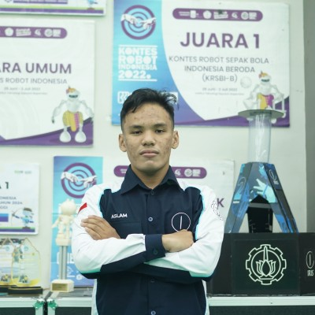

<h1 align="center">Aslam Pandu Tasminto</h1>

Mathematics Undergraduate at ITS · Robotics Software, Control Systems

<table align="center">
  <tbody>
    <tr>
      <td><b>About &amp; Contact</b></td>
      <td width="40%" rowspan="4" align="center">
        
      </td>
    </tr>
    <tr>
      <td>
        Undergraduate Mathematics student at Institut Teknologi Sepuluh Nopember (ITS) focused on autonomous robot software, control systems, computer vision. Robotics programmer for <b>IRIS ITS</b> (3rd Place, RoboCup 2026 MSL) and ML Engineer for <b>TriageBox</b> (PIMNAS 39 Silver &amp; Bronze Medalist).
        <ul>
          <li><a href="./assets/docs/Curriculum_Vitae_Aslam_Pandu_Tasminto.pdf">Curriculum Vitae (PDF)</a></li>
          <li><a href="mailto:aslampandutasminto@gmail.com">aslampandutasminto@gmail.com</a></li>
          <li><a href="https://github.com/apt2736">GitHub</a> · <a href="https://www.linkedin.com/in/aslam-pandu-tasminto">LinkedIn</a> · <a href="./pages/links.md">All Links</a></li>
        </ul>
      </td>
    </tr>
    <tr><td><b>Portfolio Sections</b></td></tr>
    <tr>
      <td>
        <ul>
          <li><a href="./pages/projects.md">Projects</a></li>
          <li><a href="./pages/experience.md">Experience</a></li>
          <li><a href="./pages/education.md">Education</a></li>
          <li><a href="./pages/qualifications.md">Skills &amp; Qualifications</a></li>
          <li><a href="./pages/extracurriculars.md">Honors</a></li>
        </ul>
      </td>
    </tr>
  </tbody>
</table>

## Featured Projects

- **[LightGBM ML Pipeline for Triage Classification and Cuffless Blood Pressure Regression](./pages/projects/ml_pipeline_triagebox.md)** — Two-stage ECG/PPG regression and ESI-to-START disaster triage pipeline (_PIMNAS 39 Silver & Bronze_).
- **[Multi-Robot Play Strategy for RoboCup Middle Size League 2026](./pages/projects/play_strategy.md)** — Decentralized Attacker, Assist, and Defender coordination with cooperative passing and layered defense (_RoboCup 2026 3rd Place_).
- **[Artificial Potential Field Obstacle Avoidance with Dynamic Acceleration Control](./pages/projects/potential_field_obs_avoidance.md)** — Discrete APF routing combined with reactive sector deflection and polar acceleration limiting.
- **[Inverse Kinematic Feedforward Control with Ellipsoid Gain Profile for MSL Natural Dribbling](./pages/projects/inv_kinematic_natural_dribble.md)** — Directional ellipsoid feedforward blended with TPS PID feedback for compliant ball handling.
