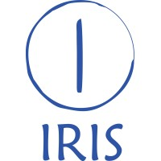
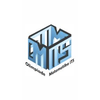

<h1 align="center">Experience</h1>
<table align="center">
  <tr>
    <td width="80%">
      <b>Programmer</b> | November 2024 - Present 
      IRIS ITS 
      <ul>
        <li>Developed Inverse Kinematics-based feedforward control with an ellipsoid gain profile for the Natural Dribble system in RoboCup Middle Size League (MSL) robots.</li>
        <li>Developed Potential Field obstacle avoidance with dynamic acceleration control based on nearest-obstacle distance for fast yet safe robot motion.</li>
        <li>Developed differential drive-like motion using Bézier curve path planning on omnidirectional robots to improve dribble stability while moving.</li>
        <li>Developed roleplay strategies (attacker/defender) with aggressive and defensive modes tailored to the active robots on the field.</li>
        <li>Developed web based dashboard User Interface for robot fine tuning.</li>
        <li>Integrating PC software to actuator drivers using CANbus, with service level safety features to minimalize buffer overflow chances and driver communication packet loss.</li>
        <li>Improved 360 degree camera masking to reduce blindspots between camera center to the lower robot base.</li>
        <li>Applied the Secant Approximation method to correct robot orientation toward empty goalpost areas, improving shooting accuracy.</li>
        <li>Experimented ball detection using YOLOv12 on panoramic projected 360 degree camera for long range multi color ball detection, with the caveat for heavy computational cost on Intel core i3/i5 10th gen integrated GPUs.</li>
        <li>Experimented robot initial pose estimation on field using Monte Carlo Localization with k-d tree scoring, with the caveat for struggling to determine which sides the robots belong to because of feature similiarity between two sides of the soccer field.</li>
        <li>Experimented ball intercept motion using Kalman Filter to predict ball future positions.</li>
        <li>ROS 1, ROS 2, OpenCV, CAN</li>
      </ul>
    </td>
    <td></td>
  </tr>
  <tr>
    <td>
      <b>Practicum Assistant - Programming and Visual Computing (PROVICOM) Lab</b> | Oct 2025 - Dec 2025 
      Institut Teknologi Sepuluh Nopember 
      <ul>
        <li>Algorithms and Java programming courses</li>
        <li>Tutored and graded 30+ students</li>
        <li>Java, NetBeans IDE</li>
      </ul>
    </td>
    <td></td>
  </tr>
  <tr>
    <td>
      <b>Game Developer</b> | May 2025 - Oct 2025 
      Olimpiade Matematika ITS (OMITS) 
      <ul>
        <li>Built an automated Examination System for OMITS 18th Semi-Final Game, efficiently processing and evaluating over 100 user submissions to determine finalists</li>
        <li>Designed and developed the game's User Interface, ensuring the game's ease to use</li>
        <li>Contributed to map layout design</li>
      </ul>
    </td>
    <td></td>
  </tr>
</table>

[Back to main page](./../README.md)
