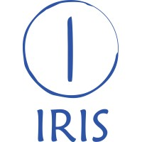
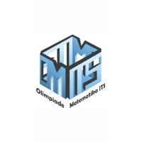

<h1 align="center">Experience</h1>
<table align="center">
  <tr>
    <td width="80%">
      <b>Programmer</b> | November 2024 – Present 
      IRIS ITS (RoboCup Middle Size League &amp; 1:10 Autonomous Car) 
      <ul>
        <li>Developed an <a href="./projects/bev_autotune_fira.md">automated Bird's Eye View (BEV) calibration system</a> using RealSense depth data and RANSAC ground-plane regression for the 1:10 scale autonomous car (1st Place, KSTI 2026 Mini Autonomous Vehicle).</li>
        <li>Developed <a href="./projects/inv_kinematic_natural_dribble.md">Inverse Kinematics-based feedforward control with an ellipsoid gain profile</a> for the Natural Dribble system in RoboCup Middle Size League (MSL) robots.</li>
        <li>Developed <a href="./projects/potential_field_obs_avoidance.md">Artificial Potential Field obstacle avoidance with dynamic acceleration control</a> based on nearest-obstacle clearance for fast, tip-free robot motion.</li>
        <li>Developed <a href="./projects/semi_diff_drive.md">differential drive-like motion using 3rd-order Bézier curve path planning</a> on omnidirectional robots to improve dribble stability while moving.</li>
        <li>Developed <a href="./projects/play_strategy.md">multi-robot play strategies</a> (Attacker, Assist, Defender) with adaptive offensive and defensive states tailored to active robots on the field (3rd Place, RoboCup 2026 MSL).</li>
        <li>Developed a web-based dashboard User Interface for real-time robot parameter fine-tuning.</li>
        <li>Integrated PC software with actuator drivers over CAN bus, adding service-level safety features to minimize buffer overflow risk and driver communication packet loss.</li>
        <li>Improved 360-degree camera masking to reduce blind spots between the camera center and lower robot base.</li>
        <li>Applied the Secant Approximation method to correct robot orientation toward empty goalpost areas, improving shooting accuracy.</li>
        <li>Experimented with ball detection using YOLOv12 on panoramic-projected 360-degree camera imagery for long-range multi-color detection (benchmarked against Intel Core i3/i5 10th-gen iGPU compute limits).</li>
        <li>Experimented with initial robot pose estimation using Monte Carlo Localization with k-d tree scoring, documenting field-symmetry ambiguity between opposing halves.</li>
        <li>Experimented with moving-ball interception using a Kalman Filter to predict future ball trajectories.</li>
      </ul>
      <b>Tech Stack:</b> ROS 1, ROS 2, OpenCV, C++, CAN bus
    </td>
    <td></td>
  </tr>
  <tr>
    <td>
      <b>Laboratory Assistant Trainee — Modelling and Simulation Laboratory</b> | Oct 2026 – Present 
      Institut Teknologi Sepuluh Nopember 
    </td>
    <td></td>
  </tr>
  <tr>
    <td>
      <b>Practicum Assistant — Programming and Visual Computing (PROVICOM) Lab</b> | Oct 2025 – Dec 2025 
      Institut Teknologi Sepuluh Nopember 
      <ul>
        <li>Assisted Algorithms and Java Programming laboratory courses.</li>
        <li>Tutored and graded 30+ undergraduate students.</li>
      </ul>
      <b>Tech Stack:</b> Java, NetBeans IDE
    </td>
    <td></td>
  </tr>
  <tr>
    <td>
      <b>Game Developer</b> | May 2025 – Oct 2025 
      Olimpiade Matematika ITS (OMITS) 
      <ul>
        <li>Built an automated examination system for the OMITS 18th Semi-Final Game, processing and evaluating over 100 participant submissions to determine finalists.</li>
        <li>Designed and developed the game's User Interface to ensure intuitive navigation and ease of use.</li>
        <li>Contributed to map layout design.</li>
      </ul>
    </td>
    <td></td>
  </tr>
</table>

[Back to Main](./../README.md)
