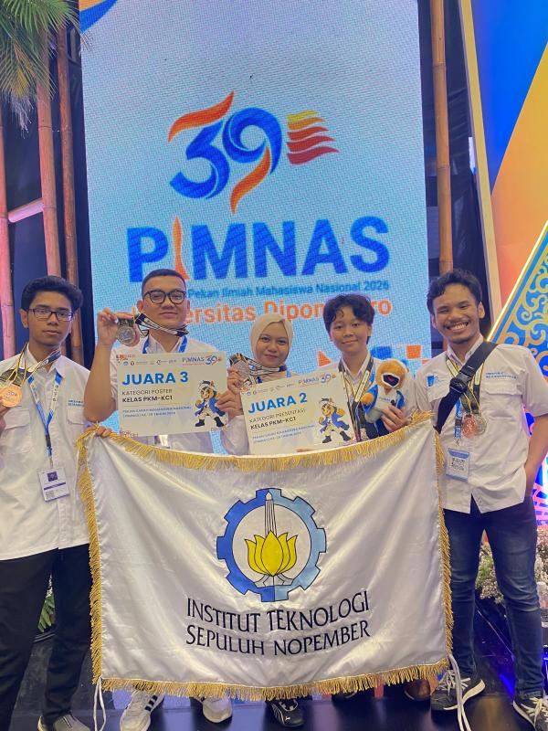
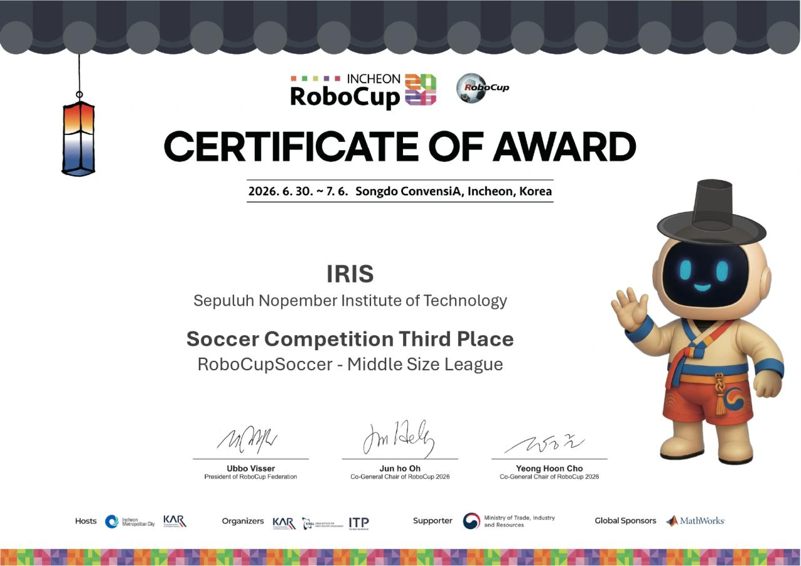
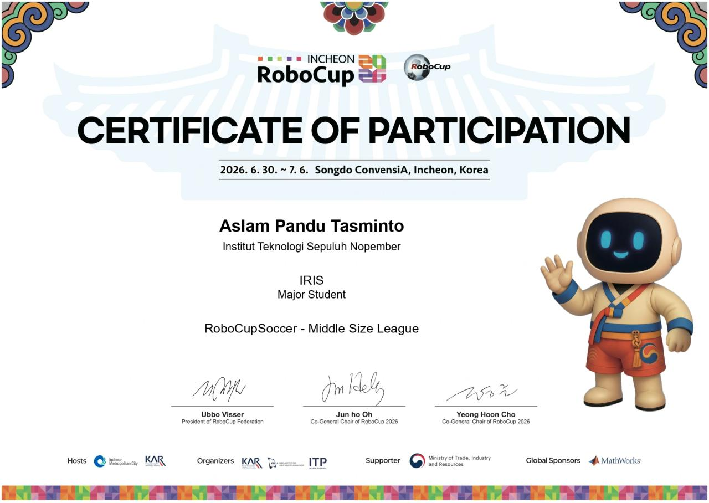

# Honors

- 1st Place Mini Autonomous Vehicle Robot Competition — Konvensi Sains Teknologi Industri (KSTI) 2026 ([1:10 Scale Autonomous Car](./projects/bev_autotune_fira.md)) - Institut Teknologi Sepuluh Nopember
- 2nd Place Presentation Category PKM-KC1 Pekan Ilmiah Mahasiswa Nasional 39 ([TriageBox ML Pipeline](./projects/ml_pipeline_triagebox.md)) - Ministry of Higher Education, Science, and Technology Republic of Indonesia
- 3rd Place Poster Category PKM-KC1 Pekan Ilmiah Mahasiswa Nasional 39 ([TriageBox ML Pipeline](./projects/ml_pipeline_triagebox.md)) - Ministry of Higher Education, Science, and Technology Republic of Indonesia
    

        
         
        Double Medal Awards
    

     
- 3rd Place Middle Size League Soccer Competition RoboCup 2026 ([IRIS ITS MSL Projects](./projects.md)) - RoboCup Federation
    

        
         
        Certificate of Award
    

     
- RoboCup 2026 Major Student Participant - RoboCup Federation
    

        
         
        Certificate of Participation
    

     

---

[Back to Main](./../README.md)
