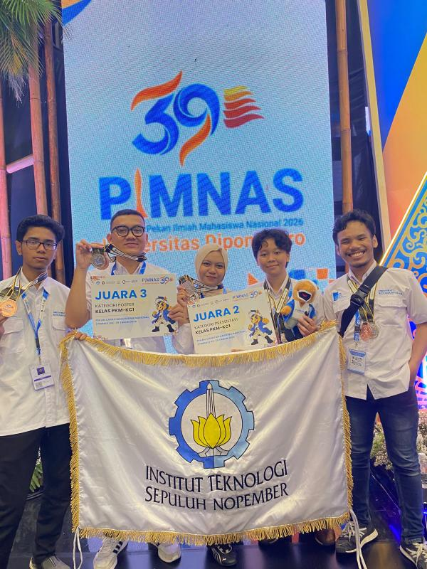
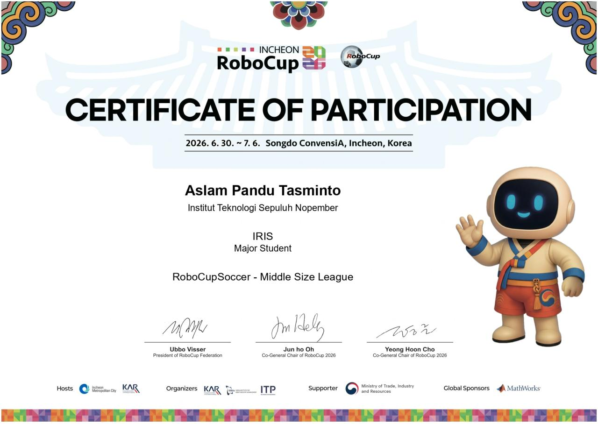

# Honors

- 2nd Place Presentation Category PKM-KC1 Pekan Ilmiah Mahasiswa Nasional 39 - Ministry of Higher Education, Science, and Technology Republic of Indonesia
- 3rd Place Poster Category PKM-KC1 Pekan Ilmiah Mahasiswa Nasional 39 - Ministry of Higher Education, Science, and Technology Republic of Indonesia
    

        
         
        Double Medal Awards
    

     
- 3rd Place Middle Size League Soccer Competition RoboCup 2026 - RoboCup Federation
    

        
         
        Certificate of Award
    

     
- RoboCup 2026 Major Student Participant - RoboCup Federation
    

        
         
        Certificate of Participation
    

     

---

[Back to Main](./../README.md)
