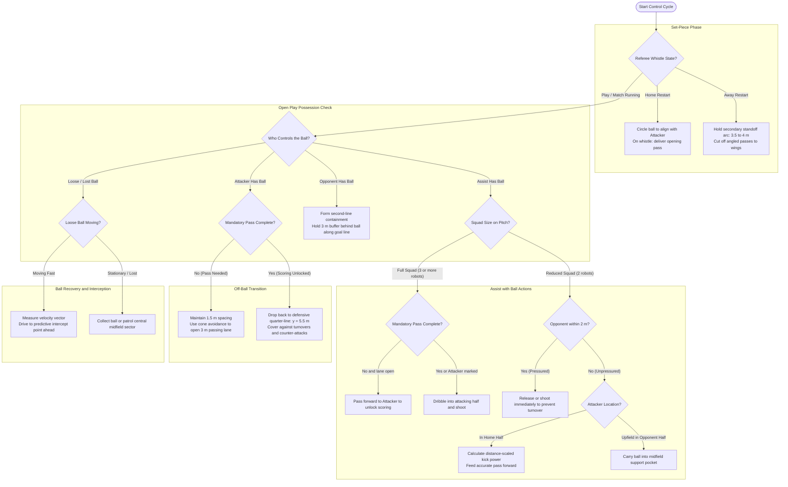
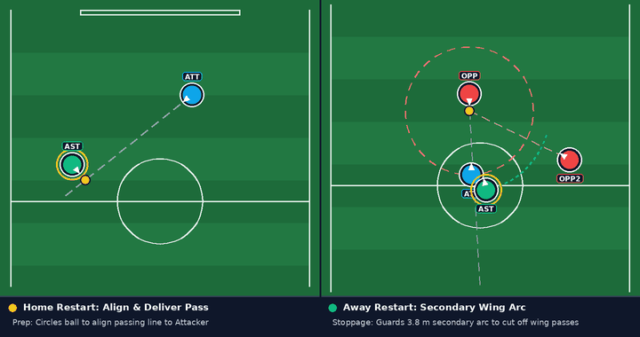
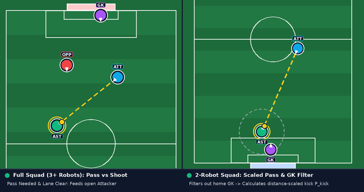
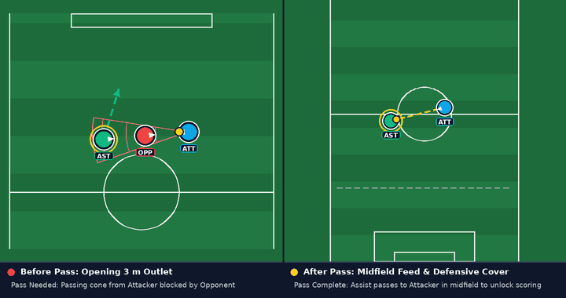
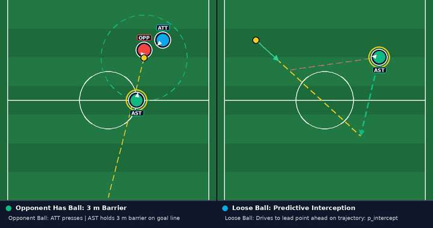

# Assist Role Play Strategy

## Introduction

Within the [Multi-Robot Play Strategy](./play_strategy.md), the Assist is the team's playmaker and central midfielder. While the [Attacker](./attacker_play_strategy.md) leads the attack and the [Defender](./defender_play_strategy.md) protects our penalty box, the Assist links both ends of the pitch by executing restarts, distributing forward passes, and recovering defensive ground.

Three main duties define the Assist role:

1. **Taking restarts**: On team set pieces, the Assist locates the ball, lines up with the Attacker, and delivers the opening pass to fulfill the mandatory pass rule.
2. **Adapting to squad size**: With three or more robots, it seeks combination passes; with two robots, it switches between direct distribution and pressure-release shots.
3. **Two-way positioning**: When the Attacker controls the ball, the Assist opens up a passing lane, then drops back to cover counter-attacks once the pass is complete.

## How it Works

### 1. Decision Flowchart

The following flowchart outlines the Assist's decision pipeline across set-piece restarts, squad-size adaptations, off-ball transitions, and ball recovery:

### 2. Set Pieces: Taking the Restart Pass

During referee stoppages, the Assist handles team set pieces:

- **On Our Restarts (Home)**: On throw-ins, free kicks, corner kicks, and goal kicks, the Assist searches the restart area to locate the ball, approaches it, and circles around until the ball sits on the line toward the Attacker. When the referee signals `Start`, the Assist passes to the Attacker and pauses briefly to avoid crowding the reception. This puts the ball in play and satisfies the mandatory pass rule in one touch.
- **On Opponent Restarts (Away)**: While the Attacker covers the central $3\text{ m}$ lane in front of the ball, the Assist guards a wider secondary arc ($3.5\text{--}4\text{ m}$ out) to cut off angled passes toward the wings.

  
   
  Assist set-piece execution: circling the ball to align and pass to Attacker on Home restarts (left) vs. guarding the 3.8 m secondary wing arc on Away restarts (right).

### 3. Playmaking with the Ball (`Has Ball`)

When the Assist wins the ball in open play, it clears the touchline or reverses away from blockers, then decides based on active teammates:

| Match Situation                | Condition Checked                                     | Assist Decision                                                   |
| :----------------------------- | :---------------------------------------------------- | :---------------------------------------------------------------- |
| **Full Squad ($3+$ Robots)**   | Mandatory pass not made and lane to Attacker is clear | Turns toward the Attacker and signals an open-play pass           |
| **Full Squad ($3+$ Robots)**   | Pass already completed, or Attacker is closely marked | Dribbles into the attacking half and shoots on goal               |
| **Reduced Squad ($2$ Robots)** | Opponent pressing within $2\text{ m}$                 | Releases or shoots the ball immediately to avoid a turnover       |
| **Reduced Squad ($2$ Robots)** | Unpressured and Attacker is in our half               | Scales kick power by distance and feeds a forward pass            |
| **Reduced Squad ($2$ Robots)** | Unpressured and Attacker is already upfield           | Carries the ball into a midfield support pocket behind the attack |

  
   
  Playmaking decisions: switching between passing and driving to shoot in a 3+ robot squad (left) vs. ignoring the home goalkeeper and scaling kick power by distance in a 2-robot squad (right).

#### Distance-Scaled Passing

When passing across midfield in two-robot play, kicking with fixed power either falls short or bounces off the receiver's dribbler. The Assist calculates kick power directly from its measured distance to the Attacker:

$$
P_{\text{kick}} = \max\!\left(P_{\min}, \; c_0 + c_1 \cdot d_{\text{attacker}}\right)
$$

When checking for nearby opponent pressure within $2\text{ m}$, the Assist filters out any detection inside our penalty box so our goalkeeper is never flagged as an opponent.

### 4. Off-Ball Movement: Support to Counter-Attack Cover (`Teammate Has Ball`)

When the Attacker controls the ball, the Assist keeps at least $1.5\text{ m}$ spacing to prevent collisions. Beyond that boundary, its behavior shifts based on the pass rule:

1. **Before the Mandatory Pass (Opening a Lane)**:
   Because the Attacker cannot score directly yet, it needs an outlet. If an opponent blocks the direct line, the Assist uses cone-based avoidance to shift out of the defender's shadow, holding an open $3\text{ m}$ target.
2. **After the Mandatory Pass (Covering Turnovers)**:
   Once the pass requirement is satisfied, the Attacker can shoot on its own. The Assist drops back to the defensive quarter-line ($y = 5.5\text{ m}$) and tracks the line between the ball and our goal. If the Attacker's shot is blocked or intercepted, the Assist is already positioned to break up the counter-attack.

  
   
  Two-way off-ball transition: opening a 3 m pass lane outside the opponent shadow cone before the pass (left) vs. passing to Attacker in midfield and dropping to the y = 5.5 m quarter-line to cover the goal (right).

### 5. Containment and Moving-Ball Interception

#### Second-Line Containment (`Opponent Has Ball`)

When an opponent controls the ball, the Attacker presses first. Rather than having two robots chase the same ball carrier and leave midfield unprotected, the Assist stays $3\text{ m}$ behind the ball along the goal line, forming a second defensive barrier.

#### Predictive Interception (`Loose Ball` & `Roaming`)

When a loose ball rolls into our defensive half while the Attacker is upfield, the Assist recovers it. If the ball is moving quickly, chasing its current position causes the robot to trail behind. The Assist measures the ball's velocity vector and drives to an intercept point $1\text{--}2\text{ m}$ ahead of the trajectory:

$$
\mathbf{p}_{\text{intercept}} = \mathbf{p}_{\text{ball}} + L_{\text{lead}} \, \hat{\mathbf{v}}_{\text{ball}}
$$

This lets the robot meet the ball cleanly without overrunning the touchline.

  
   
  Midfield recovery: holding a 3 m second-line containment buffer behind the ball (left) vs. driving to a velocity-lead intercept point ahead of a fast loose ball (right).

- [Back to Play Strategy Overview](./play_strategy.md)
- [Back to main page](./../../README.md)
