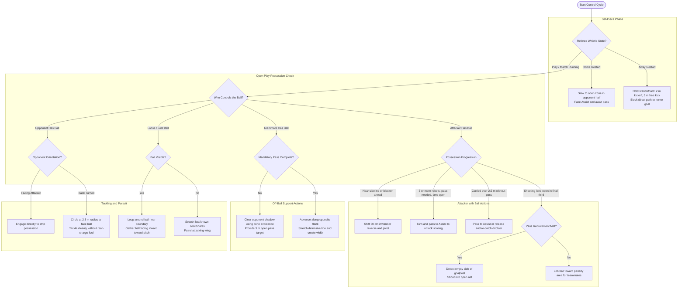
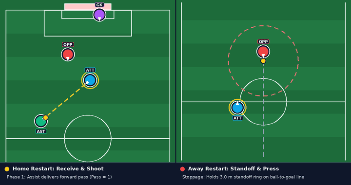
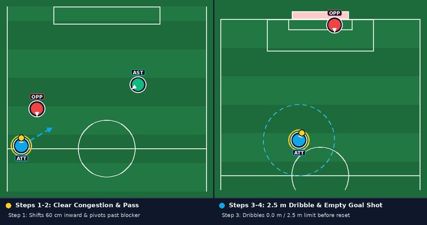
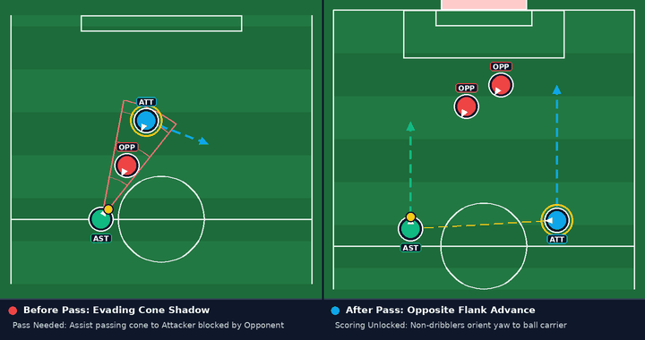
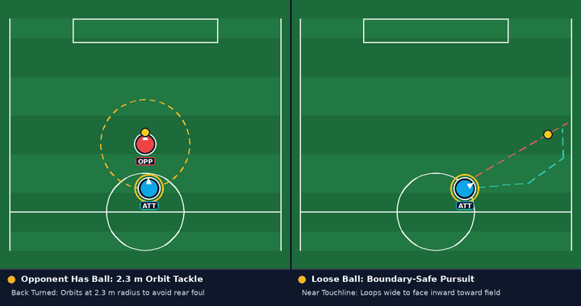

# Attacker Role Play Strategy

## Introduction

Within the [Multi-Robot Play Strategy](./play_strategy.md), the Attacker is the team's striker and front-line presser. While the [Defender](./defender_play_strategy.md) protects our penalty area and the [Assist](./assist_play_strategy.md) links play through midfield, the Attacker operates in the opponent's half to win back possession, receive passes, and score.

Three priorities guide the Attacker under RoboCup Middle Size League (MSL) rules:

1. **Ball progression**: Dribble past defenders without exceeding the $3\text{ m}$ rule limit, and confirm the team pass requirement before shooting.
2. **Clean pressing**: Circle around ball-shielding opponents to tackle from the front rather than committing rear-charging fouls.
3. **Targeted finishing**: Detect the empty side of the goalpost with camera vision and aim for the open net.

## How it Works

### 1. Decision Flowchart

The following flowchart outlines the Attacker's real-time decision loop across referee stoppages, possession states, off-ball support, and defensive recovery:

### 2. Set Pieces: Receiving Passes and Blocking Restarts

During referee stoppages, the Attacker slews its target position smoothly to prevent wheel slip:

- **On Our Restarts (Home)**: The Attacker takes an open receiving position in the opponent's half and turns to face the Assist. Once the referee restarts play, the Assist passes forward, and the Attacker gathers the ball into its dribbler. Because a pass was completed, the Attacker can immediately turn to shoot.
- **On Opponent Restarts (Away)**: The Attacker holds the legal standoff boundary ($2\text{ m}$ on kickoffs, $3\text{ m}$ on free kicks and corners), staying directly between the ball and our goal. When the opponent touches the ball into play, the Attacker breaks from the standoff ring to contest possession.

  
   
  Attacker set-piece behavior: receiving the opening pass to shoot on Home restarts (left) vs. holding the 3 m standoff ring before pressing on Away restarts (right).

### 3. Attacking with the Ball (`Has Ball`)

When the Attacker gains possession in open play, it follows a four-step sequence:

| Step                    | Trigger Condition                                        | Attacker Action                                                                                        |
| :---------------------- | :------------------------------------------------------- | :----------------------------------------------------------------------------------------------------- |
| **1. Clear Congestion** | Pinned near the touchline or blocked directly ahead      | Shifts $60\text{ cm}$ inward from the sideline, or reverses $30\text{ cm}$ and pivots past the blocker |
| **2. Mandatory Pass**   | $3+$ robots active, pass not yet made, lane is open      | Turns toward the Assist and passes so the team earns legal shooting rights                             |
| **3. Dribble Limit**    | Carried the ball $2.5\text{ m}$ from where it was caught | Passes to the Assist if open, or releases and re-catches the ball to reset the counter                 |
| **4. Goal Shot**        | Inside the attacking half with an open shooting line     | Detects the empty side of the goalpost and shoots, or lobs into the box if no prior pass occurred      |

  
   
  Four-step ball progression: clearing the sideline and passing to Assist (left) vs. respecting the 2.5 m dribble cap and shooting into the empty side of the goalpost (right).

#### Step 1: Clearing Sidelines and Blockers

If the Attacker secures the ball within $1\text{ m}$ of a sideline, it shifts $60\text{ cm}$ toward field center so momentum does not carry the ball out of bounds. If an opponent stands within $1.2\text{ m}$ in front, the Attacker reverses briefly and pivots toward open grass before driving forward.

#### Step 2: Fulfilling the Pass Rule

With three or more robots playing, MSL rules require a completed pass before scoring. While dribbling, the Attacker evaluates the line of sight to the Assist. If the team still needs a pass and the Assist is clear at least $2\text{ m}$ away, the Attacker turns and passes.

#### Step 3: Managing the $3\text{ m}$ Dribble Rule

The robot tracks its displacement from where it first caught the ball. If displacement reaches a $2.5\text{ m}$ threshold in its own half without an open shot, the Attacker either passes to the Assist or briefly releases and re-engages its dribbler to reset the distance counter.

#### Step 4: Vision-Guided Finishing

Once across midfield with a shooting lane:

- **Legal Shot (Pass Complete)**: The camera detects the empty side of the goalpost between the posts, turns the chassis toward the open gap, and fires a ground shot.
- **Unpassed Play (Pass Needed)**: If forced to release the ball without a prior pass, direct scoring is invalid. The Attacker instead lobs the ball toward the goal area for teammates to contest.

### 4. Off-Ball Movement (`Teammate Has Ball`)

When the Assist or Defender controls the ball, the Attacker adjusts based on whether the team has fulfilled its pass requirement:

- **Before Pass Completion**: If an opponent blocks the Assist's passing cone, the Attacker uses cone-based obstacle avoidance to slide out of the shadow, offering an open $3\text{ m}$ target near the center of the field.
- **After Pass Completion**: Once shooting rights are unlocked, the Attacker advances along the opposite flank from the Assist to stretch the defensive line.

  
   
  Off-ball support: sliding out of the Assist passing cone shadow to receive a pass (left) vs. advancing up the opposite wing once shooting is unlocked (right).

### 5. Pressing Opponents and Chasing Loose Balls

#### Orientation-Aware Tackling (`Opponent Has Ball`)

Running directly into an opponent's rear chassis draws a pushing foul. The Attacker determines the opponent's orientation relative to the ball:

- **Facing the Attacker**: The ball is exposed, so the Attacker engages directly to strip possession.
- **Back Turned**: The opponent's body shields the ball. The Attacker circles around at a $2.3\text{ m}$ radius until it faces the ball before closing in to tackle.

#### Boundary-Safe Pursuit (`Loose Ball` & `Roaming`)

For loose balls in the attacking half, the Attacker pursues at full speed across open turf. Near touchlines or end lines, it reduces speed and loops around the ball to face inward before making contact, preventing the ball from rolling out. If sight of the ball is lost, the Attacker checks the last known coordinates before patrolling its attacking wing.

  
   
  Defensive recovery: orbiting at a 2.3 m radius to tackle from the front without fouling (left) vs. looping behind a sideline loose ball to gather it inward (right).

- [Back to Play Strategy Overview](./play_strategy.md)
- [Back to main page](./../../README.md)
