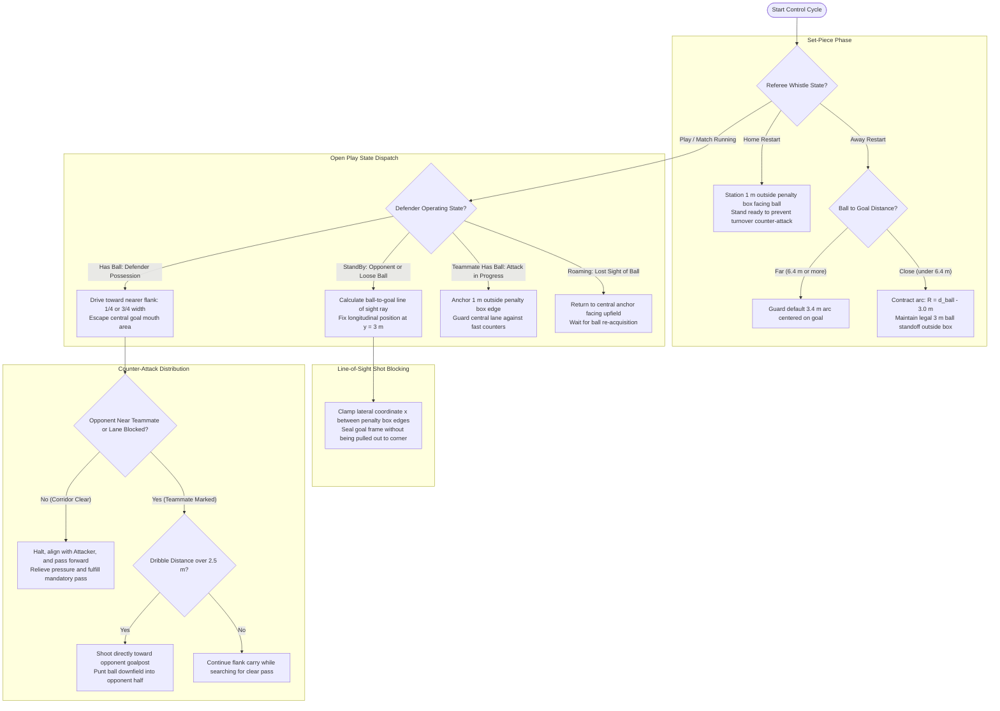
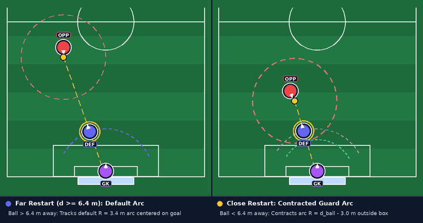
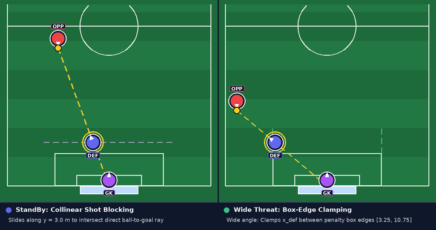
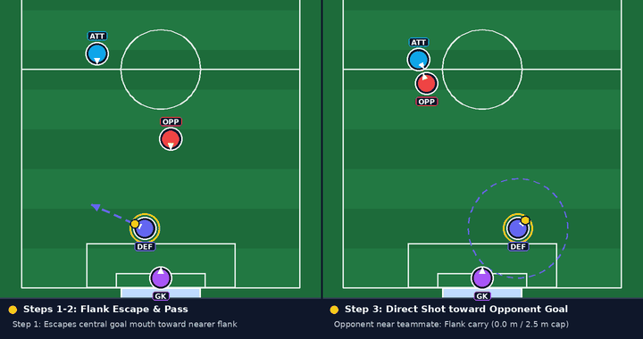
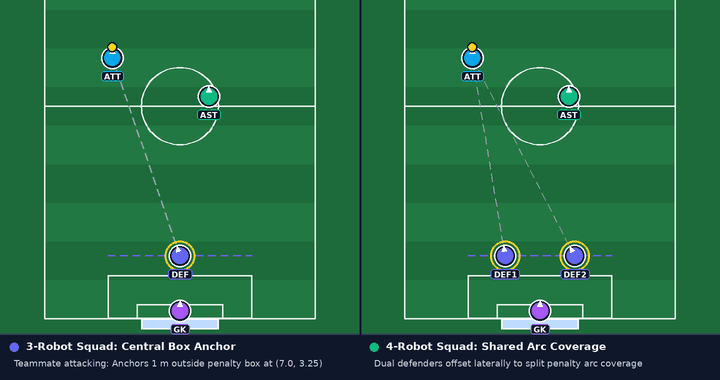

# Defender Role Play Strategy

## Introduction

Within the [Multi-Robot Play Strategy](./play_strategy.md), the Defender protects the area directly in front of our penalty box. While the [Attacker](./attacker_play_strategy.md) and [Assist](./assist_play_strategy.md) contest possession upfield, the Defender holds a disciplined defensive line, blocks direct shots on goal, and clears recovered balls into counter-attacks.

Three tactical rules govern how the Defender operates:

1. **Penalty-box restriction**: Outfield robots cannot enter their own penalty box ($2.25\text{ m}$ deep). The Defender must intercept shots outside this zone without impeding the goalkeeper.
2. **Variable restart standoff**: On opponent restarts near our goal, the Defender must stay $3\text{ m}$ clear of the ball without opening a direct path to the net.
3. **Flank clearance**: Carrying the ball across the face of goal is risky. When recovering possession, the Defender drives toward the sideline flank to pass or clear within the $3\text{ m}$ limit.

## How it Works

### 1. Decision Flowchart

The following flowchart outlines the Defender's decision pipeline across set-piece standoff arcs, penalty-line shot blocking, flank ball escapes, and downfield clearances:

### 2. Set Pieces: Adaptive Goal-Arc Guarding

During referee stoppages, the Defender focuses on protecting the central lane to our goal:

- **On Our Restarts (Home)**: The Defender holds a central station $1\text{ m}$ outside the penalty box facing the ball, ready to stop any counter-attack turnover.
- **On Opponent Restarts (Away)**: The Defender tracks a circular arc centered on our goal ($3.4\text{ m}$ from the goal line) to remain between the ball and the net. If the opponent takes a restart close to our box, holding the standard $3.4\text{ m}$ arc would place the Defender inside the illegal $3\text{ m}$ ball radius. The Defender automatically contracts its guard arc closer to the box line:

$$
R_{\text{guard}} = \min\!\left(d_{\text{ball-to-goal}} - 3.0\text{ m}, \; R_{\text{default}}\right)
$$

This keeps the Defender legally $3\text{ m}$ clear of the ball while sealing the direct shot trajectory.

  
   
  Adaptive goal-arc guarding: tracking the default 3.4 m arc on far restarts (left) vs. contracting the arc radius outside the penalty box when the opponent restarts near our goal (right).

### 3. Open Play: Line-of-Sight Shot Blocking (`StandBy`)

Unlike the Attacker and Assist, the Defender remains anchored to its defensive third during open play, switching between four focused states:

| Defender State        | Trigger Condition                            | Defender Action                                                      |
| :-------------------- | :------------------------------------------- | :------------------------------------------------------------------- |
| **StandBy**           | Opponent controls the ball, or ball is loose | Slides along the penalty line to block the ball-to-goal path         |
| **Has Ball**          | Defender catches or intercepts the ball      | Carries toward the nearer flank, passes forward, or clears downfield |
| **Teammate Has Ball** | Attacker or Assist controls the ball         | Holds the central anchor outside the box to prevent counter-attacks  |
| **Roaming**           | Cameras lose sight of the ball               | Returns to the central penalty-box anchor facing upfield             |

When blocking shots in StandBy, the Defender fixes its longitudinal position to a line $75\text{ cm}$ outside the penalty box ($3\text{ m}$ from the goal line). It calculates where the ray from the ball to the goal center intersects that defensive line:

$$
x_{\text{def}} = \operatorname{clamp}\!\left(x_{\text{ball}} + \left(y_{\text{def}} - y_{\text{ball}}\right)\dfrac{x_{\text{goal}} - x_{\text{ball}}}{y_{\text{goal}} - y_{\text{ball}}}, \; x_{\text{box,left}}, \; x_{\text{box,right}}\right)
$$

Clamping the lateral coordinate $x_{\text{def}}$ to the box edges ensures the Defender is not drawn out toward corner flags, keeping its body in front of the goal frame while tracking the ball's angle.

  
   
  Line-of-sight shot blocking: sliding along y = 3.0 m on the ball-to-goal ray (left) vs. clamping lateral travel at the penalty box edges against wide threats (right).

### 4. Ball Recovery and Counter-Attack Distribution (`Has Ball`)

When an opponent shot or loose ball enters the Defender's dribbler, it initiates a counter-attack:

1. **Escape to the Nearer Flank**:
   To prevent turnovers directly in front of the goalkeeper, the Defender dribbles toward the nearer sideline flank ($1/4$ field width on the left, or $3/4$ on the right).
2. **Scan for Forward Passes**:
   While carrying the ball toward the flank, the Defender checks the direct corridor to the Attacker. Once that lane is free of opponent obstacles, the Defender halts, aligns with the Attacker, and passes forward. This relieves defensive pressure and satisfies the team's mandatory pass requirement.
3. **Shoot Toward Opponent Goalpost**:
   When an opponent is near the teammate or closes down the pass corridor, passing or clearing toward the friend risks an immediate turnover in our defensive third. Instead of passing or kicking toward the teammate, the Defender monitors its dribble distance. Once displacement reaches $2.5\text{ m}$, it pivots directly toward the opponent goalpost and launches a direct power shot downfield, relieving pressure and clearing into the opponent half.

  
   
  Counter-attack distribution: escaping toward the nearer flank to pass forward to Attacker (left) vs. shooting directly toward the opponent goalpost when an opponent marks the teammate (right).

### 5. Holding the Anchor (`Teammate Has Ball` & `Roaming`)

When teammates have possession upfield or cameras lose the ball, the Defender holds station $1\text{ m}$ outside the top of the penalty box. In a three-robot formation, it anchors the center of the box edge; in a four-robot formation, it offsets slightly to share penalty-arc coverage with a second defender.

  
   
  Anchor positioning during upfield attacks: holding the central penalty-box station in a 3-robot squad (left) vs. splitting half-space coverage in a 4-robot squad (right).

[Back to Play Strategy Overview](./play_strategy.md)

[Back to Main](./../../README.md)
