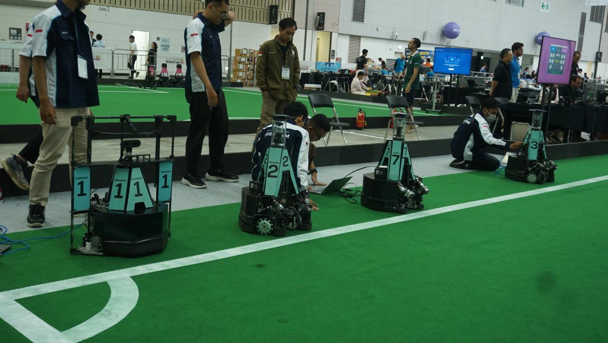
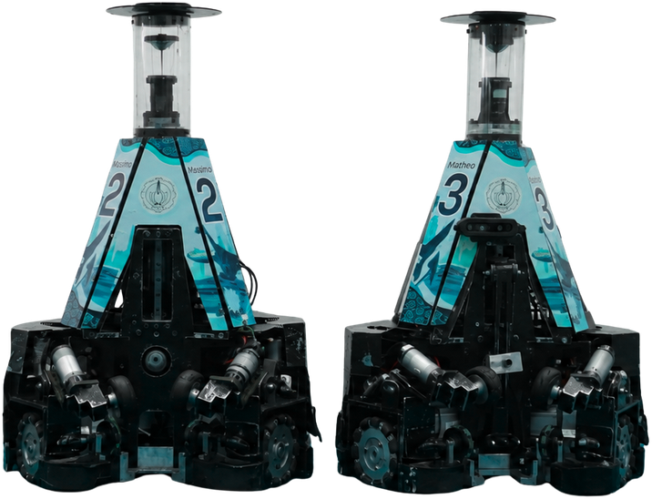
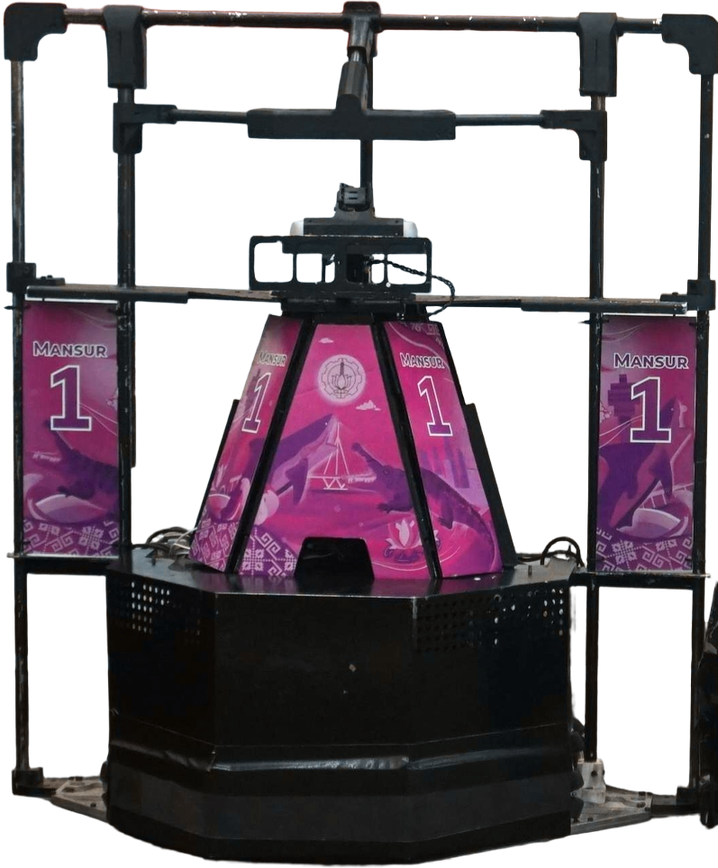
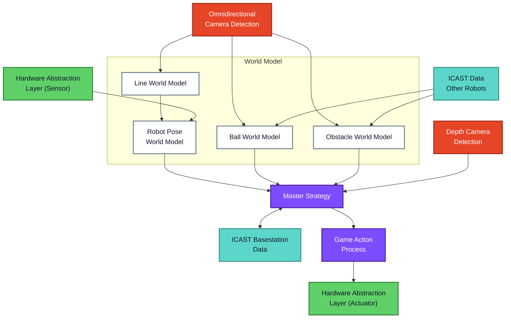

# Project Overview: IRIS ITS Middle Size League Soccer Robot

  RoboCup 2026 3rd Place
  ROS 1
  C++
  CAN Bus

 

  
   
  The Generation 5 IRIS ITS Middle Size League fleet (Goalkeeper Mansur #1 and Outfield robots Massimo #2, Pabel #7, and Matheo #3) during pre-match preparation at RoboCup 2026 in Incheon, South Korea.

## 1. Team Profile & Competition Context

**IRIS** is the autonomous soccer and wheeled robotics research team of **Institut Teknologi Sepuluh Nopember (ITS)** in Surabaya, Indonesia. Founded in 2016 to compete in _Kontes Robot Indonesia (KRI)_, the team has focused since 2017 on the Indonesian national wheeled soccer division (**KRSBI-B**, _Kontes Robot Sepak Bola Indonesia Beroda_) and the international **RoboCup Middle Size League (MSL)** and **RoboCup Asia-Pacific (RCAP)**. The team is organized into four divisions: **Programming** (perception, localization, motion control, multi-agent strategy, and basestation software), **Electrical** (power distribution, custom PCBs, solenoid kicker electronics, and embedded STM32 firmware), **Mechanical** (omnidirectional chassis, compliant dribbler suspension, and kicker mechanisms), and **Official** (operations, sponsorship, and team management).

In the **RoboCup Middle Size League**, teams of up to five fully autonomous wheeled robots play on an indoor artificial turf pitch measuring 14 m × 22 m (8 m × 12 m for 3v3 national KRSBI-B tournaments) using a standard FIFA Size 5 soccer ball. Once a match starts, human control is not permitted: an off-field **BaseStation** computer only relays official Referee Box signals (kick-off, free kick, penalty, throw-in, stop) over Wi-Fi, while all visual perception, self-localization, role assignment, path planning, and motor control run onboard each robot.

### Competition Track Record (MSL Division)

| Year     | Competition                                           | Achievement                                                            |
| :------- | :---------------------------------------------------- | :--------------------------------------------------------------------- |
| **2026** | **RoboCup World Championship (Incheon, South Korea)** | **3rd Place (Middle Size League Tournament)**                          |
| **2024** | RoboCup World Championship (Eindhoven, Netherlands)   | 5th Place Technical Challenge & 6th Place Scientific Challenge         |
| **2024** | Kontes Robot Indonesia (KRSBI-B)                      | 2nd Place Regional II & Best Design Award                              |
| **2023** | Kontes Robot Indonesia (KRSBI-B)                      | 3rd Place National, 1st Place Regional II, Best Design & Best Strategy |
| **2022** | **RoboCup World Championship (Bangkok, Thailand)**    | **3rd Place (Middle Size League Tournament)**                          |
| **2022** | **RoboCup Asia-Pacific (RCAP)**                       | **1st Place Open Challenge & 1st Place Cooperation Challenge**         |
| **2022** | Kontes Robot Indonesia (KRSBI-B)                      | 2nd Place National, 2nd Place Regional II & Best Strategy Award        |

---

## 2. Robot Fleet & System Architecture

Across five mechanical generations developed between 2017 and 2026 (Gen 1–2 in 2017, Gen 3 in 2019, Gen 4 in 2021, and Gen 5 from 2021 to the present), IRIS converged on two specialized robot platforms tailored to their field roles: three **Outfield / Striker Robots** (_Massimo #2_, _Matheo #3_, and _Pabel #7_) built for agile 360° ball handling and high-speed passing/shooting, and one **Goalkeeper Robot** (_Mansur #1_) built for rapid lateral goal-line coverage and 3D shot interception.

  <table>
    <tr>
      <th align="center">Outfield / Striker Platform</th>
      <th align="center">Goalkeeper Platform</th>
    </tr>
    <tr>
      <td align="center">
        
      </td>
      <td align="center">
        
      </td>
    </tr>
    <tr>
      <td align="center"><em>Gen 5 Outfield Robots: Massimo (#2) and Matheo (#3)</em></td>
      <td align="center"><em>Gen 5 Goalkeeper Robot: Mansur (#1)</em></td>
    </tr>
  </table>

### Hardware & Embedded Specification Comparison

| Subsystem                           | Outfield / Striker Robots (_Massimo #2, Matheo #3, Pabel #7_)                                                                                              | Goalkeeper Robot (_Mansur #1_)                                                                               |
| :---------------------------------- | :--------------------------------------------------------------------------------------------------------------------------------------------------------- | :----------------------------------------------------------------------------------------------------------- |
| **Chassis & Drive Layout**          | Triangular 3-omniwheel holonomic base (120°, 240°, 0°) driven by brushed DC (BDC) motors with industrial servo drives (Elmo / Beckhoff)                    | Rhombus 4-omniwheel holonomic base driven by BDC motors with extendable upper goal-blocking frame            |
| **Primary Vision System**           | 360° catadioptric omnidirectional camera (upward camera facing a hyperbolic mirror tower) for full-field perception                                        | Active pan-tilt mechanism carrying an **Intel RealSense RGB-D** depth camera for 3D ball trajectory tracking |
| **Ball Handling (Dribbler)**        | Dual-roller BDC dribbler mounted on a compliant spring-loaded dynamic suspension with a Throttle Position Sensor (TPS) measuring arm deflection            | Dual-roller BDC dribbler with dynamic spring suspension                                                      |
| **Kicking Mechanism**               | High-power electromagnetic solenoid kicker powered by a boosted capacitor bank for flat passes and long-range shots                                        | High-power electromagnetic solenoid clearance kicker                                                         |
| **Onboard Compute & Low-Level I/O** | Onboard x86 mini-PC (10th-Gen Intel Core i3/i5) communicating over EtherCAT / CAN bus with an **STM32F4 Discovery** microcontroller                        | Onboard x86 mini-PC paired with an **STM32F4 Discovery** microcontroller                                     |
| **Odometry & Inertial Sensors**     | 3 motor encoders + 2 passive dead-wheel rotary encoders, **MPU6050** 6-axis IMU / gyroscope, Sharp GP analog distance sensor, and optical proximity sensor | 2 passive dead-wheel rotary encoders, IMU, and optical ball-possession proximity sensor                      |
| **Power Supply**                    | 2 × 20 V Li-ion batteries (logic & auxiliary actuation) + 1 × 16 V high-discharge LiPo battery (traction drives)                                           | 2 × 24 V Li-ion battery packs                                                                                |

### Main Control Software Topology

The onboard Mini-PC runs a customized Linux-based OS with **ROS** (started automatically at boot via Linux `systemd`), divided into five packages: **Communication** (UDP multicast with TDMA for robot-to-robot and BaseStation exchange), **Hardware** (Hardware Abstraction Layer bridging EtherCAT sensors and CAN bus motor drivers), **Vision** (omnidirectional and depth camera detection), **World Model** (global field-frame estimation of lines, ball, obstacles, and robot pose), and **Strategy** (tactical decision-making and game action execution):

---

## 3. Core Autonomous Control & Strategy Modules

My primary engineering work for the RoboCup 2026 campaign focused on four core control, motion-planning, and multi-agent strategy subsystems, each documented in its own technical article:

  

    
<a href="{{ '/pages/projects/inv_kinematic_natural_dribble.html' | relative_url }}">1. Inverse Kinematic Feedforward Control with Ellipsoid Gain Profile for MSL Natural Dribbling</a>

    Apr 2026
  

  
Feedforward dribbler speed control using a 2D ellipsoid gain profile blended with TPS PID feedback to reduce ball slip and phase lag under RoboCup's <em>natural dribbling</em> rule.

  

    
<a href="{{ '/pages/projects/potential_field_obs_avoidance.html' | relative_url }}">2. Artificial Potential Field Based Obstacle Avoidance with Dynamic Acceleration Control</a>

    May 2026
  

  
World-frame Artificial Potential Field obstacle avoidance paired with reactive sector steering and dynamic acceleration limits to keep the robot from tipping during evasive turns.

  

    
<a href="{{ '/pages/projects/semi_diff_drive.html' | relative_url }}">3. Differential Drive-like Motion on Omnidirectional Robot with 3rd-Order Bézier Curve Path Planning</a>

    Apr 2026
  

  
Cubic Bézier path following and ball-centered 180° turns that keep the dribbler aligned with the robot's travel direction at speed.

  

    
<a href="{{ '/pages/projects/play_strategy.html' | relative_url }}">4. Multi-Robot Play Strategy for RoboCup Middle Size League 2026</a>

    Jun 2026
  

  
Role-based play strategy for Attacker, Assist, and Defender covering set pieces, passing coordination, and layered defense across variable team sizes.

---

## 4. Supporting Engineering Contributions

Beyond the four major modules above, keeping the fleet reliable across matches and tight venue setup windows involved several smaller but practical improvements across vision, embedded communication, and operator tooling.

### Open-Goal Aiming with Secant Approximation

Shooting straight at the center of the opponent's goal usually sends the ball directly into the goalkeeper. Using the robot's existing 360° camera and omnidirectional projection model, we project the opponent's goal area into the camera view to locate the largest unobstructed opening to the left or right of the goalkeeper, locking onto one side when both gaps are similar in size so the robot does not hesitate. Because the curved mirror introduces nonlinear distortion when mapping that visual direction back onto the real goal line, I applied the **Secant Approximation** method to iteratively refine the world-frame target coordinate until its projected camera angle matches the observed open space. This gave our strikers consistent corner aiming without requiring an extra forward-facing camera.

### Omnidirectional Camera Masking

Because the upward-facing camera looks down onto a curved mirror mounted above the chassis, the center of the image reflects the robot's own lower body and dribbler arms. Previously, masking that area with a single fixed black circle created an awkward compromise: too small a circle let dark chassis reflections leak into the field view and appear as phantom obstacles right on top of the robot, while too large a circle created a blind ring that hid the ball as it approached the dribbler. I refined the inner masking logic so self-occluded chassis areas are excluded from obstacle false positives while keeping the near-field ball channel open all the way to the dribbler intake, improving both close-range ball tracking and obstacle reliability.

### CAN Bus Actuator Integration and Safety

The onboard PC communicates with the three omnidirectional traction motor drivers over CAN bus to exchange high-rate encoder readings and motor torque commands. During live matches, high-current kicker discharges and sudden direction changes can introduce bus noise or momentary packet drops, which previously risked filling the receive buffer with stale frames or stalling the motion loop. I integrated the PC-to-driver CAN communication with service-level safeguards: flushing stale receive frames before each sync cycle, bounding read operations with timeouts so a missed reply cannot freeze control, and automatically re-initializing drivers if they recover from a brief power dip, alongside clean freedrive toggling and safe shutdown resets.

### Web-Based Parameter Tuning Dashboard

Lighting conditions, turf friction, and dribbler spring tension change from one competition hall to another, leaving little time to edit config files or recompile code during setup. I developed a browser-based tuning dashboard connected to each robot over Wi-Fi so the team can inspect the live field map and adjust dribble gains, motion PIDs, kicker offsets, vision color thresholds, and starting robot pose in real time, saving tuned presets directly back to the robot's configuration.

---

## 5. Experimental R&D & Engineering Trade-Offs

During the 2025–2026 season, I also explored three experimental perception and state-estimation ideas. Testing them on the actual robot hardware clarified where each approach shines and where compute or field-geometry limits made simpler alternatives better suited for RoboCup 2026.

### Panoramic Ball Detection with YOLOv12

Standard color-threshold vision struggles under harsh venue glare or when matches introduce multi-colored soccer balls at long range, while running object detectors directly on raw circular 360° mirror frames hurts accuracy because the mirror stretches objects near the edges. I built an experimental pipeline that unwraps the circular camera feed into a flat panoramic strip (splitting and stacking the two 180° halves to fit a square network input) and runs **YOLOv12** through OpenVINO. While unwrapping removed radial distortion and improved long-range multi-color detection, combining full-frame remapping with neural inference on our robots' 10th-generation Intel Core i3/i5 integrated GPUs reduced frame rate below what fast match play requires. We kept the faster color-based pipeline for competition while retaining the panoramic detector as a ready backend for future onboard compute upgrades.

### Initial Pose Estimation with Monte Carlo Localization

Our robots track their position continuously during play by matching detected white field lines against a reference pitch map using Iterative Closest Point (ICP), which is fast and accurate once initialized near the true pose. To automate startup localization without manually setting the starting position, I experimented with **Monte Carlo Localization (MCL)** scored via a k-d tree against the field line map. Although the particle filter quickly aligned onto the white lines, a regulation soccer field is geometrically identical when rotated 180° around the center circle, so line geometry alone produced equal confidence on both halves of the pitch. Without asymmetric field landmarks, seeding the starting half from the web dashboard and letting ICP lock onto the lines proved simpler and immune to half-field flips.

### Moving-Ball Prediction with a Kalman Filter

To help robots intercept fast passes instead of chasing where the ball was a moment earlier, I prototyped a **Kalman Filter** that estimates both ball position and velocity in real time while compensating for camera pipeline delay during rapid robot movement. When the estimated ball speed exceeds a noise threshold, the filter projects a short sequence of future ball waypoints along its path, giving receiving and intercepting behaviors a target point ahead of the rolling ball.
