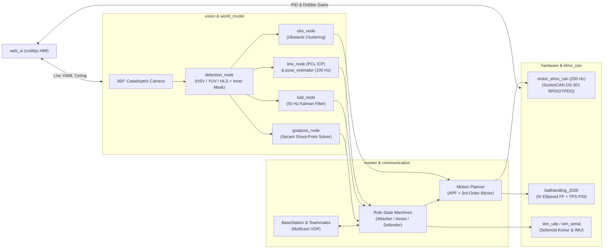

# Project Overview: IRIS ITS Middle Size League Soccer Robot

  RoboCup 2026 3rd Place
  ROS 1
  C++
  OpenCV
  PCL
  SocketCAN (CANopen)
  OpenVINO
  Multi-Robot Systems

  
   
  <em>The Generation 5 IRIS ITS Middle Size League fleet (Goalkeeper Mansur #1 and Outfield robots Massimo #2, Pabel #7, and Matheo #3) during pre-match preparation at RoboCup 2026 in Incheon, South Korea.</em>

## 1. Team Profile & Competition Context

**IRIS** is the autonomous soccer and wheeled robotics research team of **Institut Teknologi Sepuluh Nopember (ITS)** in Surabaya, Indonesia. Founded in 2016 to compete in *Kontes Robot Indonesia (KRI)*, the team has focused since 2017 on the Indonesian national wheeled soccer division (**KRSBI-B**, *Kontes Robot Sepak Bola Indonesia Beroda*) and the international **RoboCup Middle Size League (MSL)** and **RoboCup Asia-Pacific (RCAP)**. The team is organized into four divisions: **Programming** (perception, localization, motion control, multi-agent strategy, and basestation software), **Electrical** (power distribution, custom PCBs, solenoid kicker electronics, and embedded STM32 firmware), **Mechanical** (omnidirectional chassis, compliant dribbler suspension, and kicker mechanisms), and **Official** (operations, sponsorship, and team management).

In the **RoboCup Middle Size League**, teams of up to five fully autonomous wheeled robots compete on an indoor artificial turf pitch measuring $14\text{ m} \times 22\text{ m}$ ($8\text{ m} \times 12\text{ m}$ for 3v3 national KRSBI-B competitions) using a standard FIFA Size 5 soccer ball. Once a match begins, no human operator intervention is permitted: an off-field **BaseStation** computer is restricted to relaying official Referee Box signals (kick-off, free kick, penalty, throw-in, stop) over Wi-Fi, while all visual perception, self-localization, role assignment, path planning, and actuator control run locally on each robot.

### Competition Track Record (MSL Division)

| Year | Competition | Achievement |
| :--- | :--- | :--- |
| **2026** | **RoboCup World Championship (Incheon, South Korea)** | **3rd Place (Middle Size League Tournament)** |
| **2024** | RoboCup World Championship (Eindhoven, Netherlands) | 5th Place Technical Challenge & 6th Place Scientific Challenge |
| **2024** | Kontes Robot Indonesia (KRSBI-B) | 2nd Place Regional II & Best Design Award |
| **2023** | Kontes Robot Indonesia (KRSBI-B) | 3rd Place National, 1st Place Regional II, Best Design & Best Strategy |
| **2022** | **RoboCup World Championship (Bangkok, Thailand)** | **3rd Place (Middle Size League Tournament)** |
| **2022** | **RoboCup Asia-Pacific (RCAP)** | **1st Place Open Challenge & 1st Place Cooperation Challenge** |
| **2022** | Kontes Robot Indonesia (KRSBI-B) | 2nd Place National, 2nd Place Regional II & Best Strategy Award |

---

## 2. Robot Fleet & System Architecture

Across five mechanical generations developed between 2017 and 2026 (Gen 1–2 in 2017, Gen 3 in 2019, Gen 4 in 2021, and Gen 5 from 2021 to the present), IRIS converged on two specialized robot platforms tailored to their field roles: three **Outfield / Striker Robots** (*Massimo #2*, *Matheo #3*, and *Pabel #7*) built for agile 360° ball handling and high-speed passing/shooting, and one **Goalkeeper Robot** (*Mansur #1*) built for rapid lateral goal-line coverage and 3D shot interception.

| Outfield / Striker Platform | Goalkeeper Platform |
|:---:|:---:|
|||
|*Gen 5 Outfield Robots: Massimo (#2) and Matheo (#3)*|*Gen 5 Goalkeeper Robot: Mansur (#1)*|

### Hardware & Embedded Specification Comparison

| Subsystem | Outfield / Striker Robots (*Massimo #2, Matheo #3, Pabel #7*) | Goalkeeper Robot (*Mansur #1*) |
| :--- | :--- | :--- |
| **Chassis & Drive Layout** | Triangular 3-omniwheel holonomic base ($120^\circ$, $240^\circ$, $0^\circ$) driven by brushed DC (BDC) motors with industrial servo drives (Elmo / Beckhoff) | Rhombus 4-omniwheel holonomic base driven by BDC motors with extendable upper goal-blocking frame |
| **Primary Vision System** | 360° catadioptric omnidirectional camera (upward camera facing a hyperbolic mirror tower) for full-field $360^\circ$ perception | Active pan-tilt mechanism carrying an **Intel RealSense RGB-D** depth camera for 3D ball trajectory tracking |
| **Ball Handling (Dribbler)** | Dual-roller BDC dribbler mounted on a compliant spring-loaded dynamic suspension with a Throttle Position Sensor (TPS) measuring arm deflection | Dual-roller BDC dribbler with dynamic spring suspension |
| **Kicking Mechanism** | High-power electromagnetic solenoid kicker powered by a boosted capacitor bank for flat passes and long-range shots | High-power electromagnetic solenoid clearance kicker |
| **Onboard Compute & Low-Level I/O** | Onboard x86 mini-PC (10th-Gen Intel Core i3/i5) communicating over SocketCAN / Ethernet with an **STM32F4 Discovery** microcontroller | Onboard x86 mini-PC paired with an **STM32F4 Discovery** microcontroller |
| **Odometry & Inertial Sensors** | 3 motor encoders + 2 passive dead-wheel rotary encoders, **MPU6050** 6-axis IMU / gyroscope, Sharp GP analog distance sensor, and optical proximity sensor | 2 passive dead-wheel rotary encoders, IMU, and optical ball-possession proximity sensor |
| **Power Supply** | $2 \times 20\text{ V}$ Li-ion batteries (logic & auxiliary actuation) + $1 \times 16\text{ V}$ high-discharge LiPo battery (traction drives) | $2 \times 24\text{ V}$ Li-ion battery packs |

### Onboard ROS 1 Software Stack

Each robot runs a distributed **ROS 1** (C++17) node graph that separates high-rate hardware loops from vision processing and tactical decision-making:

---

## 3. Core Autonomous Control & Strategy Modules

My primary engineering work for the RoboCup 2026 campaign focused on four core control, motion-planning, and multi-agent strategy subsystems, each documented in its own technical article:

  

    
<a href="{{ '/pages/projects/inv_kinematic_natural_dribble.html' | relative_url }}">1. Inverse Kinematic Feedforward Control with Ellipsoid Gain Profile for MSL Natural Dribbling</a>

    Apr 2026
  

  
Couples robot translational and rotational velocities $(v\_x, v\_y, \omega)$ directly to left and right dribbler roller speeds via a direction-dependent 2D ellipsoid feedforward gain profile, blended with Throttle Position Sensor (TPS) PID feedback to eliminate phase lag and forward/lateral ball slip under RoboCup's <em>natural dribbling</em> rule.

  

    
<a href="{{ '/pages/projects/potential_field_obs_avoidance.html' | relative_url }}">2. Artificial Potential Field Based Obstacle Avoidance with Dynamic Acceleration Control</a>

    May 2026
  

  
Combines a discrete world-frame Artificial Potential Field (APF) grid planner with a local reactive sector-avoidance layer and a clearance-scaled polar velocity-step limiter, preventing the tall, high-center-of-gravity robot from tipping during sudden evasive maneuvers.

  

    
<a href="{{ '/pages/projects/semi_diff_drive.html' | relative_url }}">3. Differential Drive-like Motion on Omnidirectional Robot with 3rd-Order Bézier Curve Path Planning</a>

    Apr 2026
  

  
Constrains the holonomic 3-wheel base during ball possession to track smooth De Casteljau cubic Bézier trajectories while aligning chassis heading with the velocity tangent, and executing ball-centered $180^\circ$ pivots prior to reverse segments so the ball never rolls out of the narrow dribbler jaws.

  

    
<a href="{{ '/pages/projects/play_strategy.html' | relative_url }}">4. Multi-Robot Play Strategy for RoboCup Middle Size League 2026</a>

    Jun 2026
  

  
Decentralized tactical state machines coordinating Attacker, Assist, and Defender roles across dynamic 1v1, 2v2, and 3v3 field states, including cooperative passing handshakes, rules-compliant set-piece standoffs, and three-layer defensive containment.

---

## 4. Supporting Engineering & Subsystem Contributions

Beyond the four major modules above, fielding a reliable fleet across a week-long tournament required several supporting perception, embedded communication, and tooling improvements across the onboard stack.

### 4.1 Open-Goal Target Refinement via Secant Approximation

When an outfield robot prepares to shoot, aiming blindly at the geometric center of the opponent goal $(X\_{\text{goal,center}}, Y\_{\text{goal}})$ usually sends the ball straight into the opposing goalkeeper. To identify unobstructed goal sectors in real time without adding a second forward camera, `goalpost_node` uses the robot's existing 360° catadioptric image and calibrated Scaramuzza omnidirectional camera model (`ocam_model`):

1. **3D-to-2D Goalpost Polygon Projection**: Given the robot's current world pose $(x\_r, y\_r, \theta\_r)$, the four 3D corners of the opponent goal frame ($z \in [0, 700]\text{ mm}$) are transformed into the robot's local frame and projected onto the 2D catadioptric image plane via `world2cam(&ocam_model)`, forming a binary region-of-interest polygon mask (`frame_goalpost`).
2. **Open-Sector Contour Extraction & Hysteresis Locking**: Inside this projected goal polygon, the HSV image is segmented to isolate open goal-net regions from the opponent goalkeeper and defenders. The two largest open-goal contours (left and right of the goalkeeper) are extracted via image moments, and their centroids yield candidate visual aiming bearings. If the left and right open areas differ by less than $200\text{ px}^2$, a hysteresis side-lock (`lock_kiri` / `lock_kanan`) latches the initially larger side so the robot does not oscillate between the left and right posts during its shooting approach.
3. **Secant Approximation for Nonlinear Reprojection Correction**: Rotating the local goalpost center vector by the image-plane angular difference $\Delta \theta = \theta\_{\text{vision}} - \theta\_{\text{goal,frame}}$ provides an initial world-frame target estimate $(x\_0, Y\_{\text{goal}})$. However, because the hyperbolic catadioptric mirror mapping is radially nonlinear, projecting $(x\_0, Y\_{\text{goal}})$ back through `world2cam` produces a reprojected bearing $\theta\_{\text{reproj}}(x\_0)$ that deviates from the true visual centroid bearing $\theta\_{\text{vision}}$.

To eliminate this angular bias without computing analytical Jacobians of the polynomial omnidirectional model, we solve the 1D root-finding problem $f(x) = \theta\_{\text{reproj}}(x) - \theta\_{\text{vision}} = 0$ along the goal line ($y = Y\_{\text{goal}}$) using the **Secant Method**:

$$x_{k+1} = x_k - f(x_k)\,\frac{x_k - x_{k-1}}{f(x_k) - f(x_{k-1})}$$

initialized with $x\_{k-1} = X\_{\text{goal,center}}$ and $x\_k = x\_0$. Each update is guarded against small denominators ($|x\_k - x\_{k-1}| \ge 10^{-3}$, $|f'(x\_k)| \ge 10^{-4}$), clamped to a maximum step of $|\Delta x\_k| \le 50\text{ cm}$, and terminated once $|f(x\_k)| \lt 0.1^\circ$ (typically converging in fewer than 10 iterations out of a 50-iteration budget). The converged coordinate $x^*$ is then clamped inside the physical goalposts with a $20\text{ cm}$ post safety margin and $10\text{ cm}$ goalkeeper clearance offset.

### 4.2 360° Catadioptric Camera Masking & Blind-Spot Recovery

In our upward-facing catadioptric camera setup, the central disc of the image around `(center_cam_x, center_cam_y)` reflects the robot's own lower chassis, dribbler housing, and mirror mount. In earlier seasons, the vision node applied a hard black circular cutout of radius `inner_mask_radius` across all segmentation channels. That static cutout created a trade-off:
- Setting `inner_mask_radius` too small allowed dark chassis and dribbler-arm reflections to leak into the field convex hull, where the obstacle detector (which classifies non-field, non-ball, non-line pixels inside the field hull as obstacles) falsely detected the robot's own body as a zero-distance obstacle.
- Setting `inner_mask_radius` too large created a near-field blind ring around the robot base, causing the vision node to lose track of the ball or white penalty-box lines right as the ball entered the dribbler intake.

To resolve this, I reworked the inner masking stage in `detection_node` using a two-layer mask:
1. **Inverted Inner-Annulus Field Recovery (`camera_inverted_mask`)**: Within an expanded inner disc of radius `inner_mask_radius + 7`, non-green pixels corresponding to the robot's own lower base are isolated by intersecting the disc with `threshold_field`, inverting the result, applying $2 \times 2$ elliptical dilation/erosion (`MORPH_ELLIPSE`), and merging (`bitwise_or`) the recovered mask back into `threshold_field` prior to convex-hull extraction. This bridges the self-occluded chassis ring so the field hull remains continuous right up to the robot center without triggering false self-obstacles.
2. **Unmasked Near-Field Ball Detection & Radial Inward Edge Scanning**: The ball segmentation channel (`camera_mask_ball`) omits the inner cutout inside `outer_mask_radius`, allowing orange/multi-color ball blobs to remain visible even when tucked between the dribbler arms. In `findBallCenter`, rather than reporting the raw area centroid $(c\_x, c\_y)$ of a close-range ball contour (which shifts outward due to perspective stretching on the hyperbolic mirror), a radial ray is cast inward from $(c\_x, c\_y)$ toward `(center_cam_x, center_cam_y)` to locate the innermost ball boundary pixel facing the robot, improving close-range distance consistency.

### 4.3 CANopen Actuator Driver Integration & Service-Level Safety

The three omnidirectional traction wheels on our Gen 5 robots are driven over a $1\text{ Mbps}$ CAN bus (`can0`) using the **CANopen DS-301 / DS-402** protocol (`elmo_can` and `motor_elmo_can`). The PC control loop runs at $250\text{ Hz}$ ($\Delta t = 4\text{ ms}$), converting robot-frame velocity commands $(v\_x, v\_y, \omega)$ into wheel velocity targets, scaling per-wheel acceleration limits proportionally to velocity error (`controlAccelCoupled`), and running a digital PI velocity-to-torque loop that transmits 16-bit target torques via synchronous Receive Process Data Objects (**RPDO1**, COB-ID `0x200 + node_id`, object `0x6071`) while reading 32-bit encoder velocities via Transmit Process Data Objects (**TPDO1**, COB-ID `0x180 + node_id`, object `0x6069`).

Under match conditions, where high-current solenoid discharges and rapid motor reversals induce EMI spikes on the bus, naive blocking socket reads caused two failure modes: kernel receive-buffer saturation from stale asynchronous frames, and control-loop freezes when a single motor driver dropped a packet or brownout-reset. To harden the driver layer, I added four service-level safety mechanisms:
- **Non-Blocking Receive Buffer Flushing (`elmo_can_clear_recv_buffer`)**: Immediately prior to broadcasting each CANopen `SYNC` frame (`0x080`), the raw SocketCAN descriptor is temporarily switched to `O_NONBLOCK` via `fcntl` and drained in a tight `read()` loop until `EAGAIN`, guaranteeing that the subsequent TPDO read window only processes fresh encoder snapshots from the current $4\text{ ms}$ cycle.
- **Timeout-Guarded `select()` Reads & Watchdog Counters**: Every SDO and TPDO read is gated by `select()` with a bounded timeout and a per-cycle iteration cap (`cntr_jumlah > 20`). If fewer than three wheel nodes respond within the window, the loop increments `counter_motor_mati` and flags `status_motor_hidup = 0` rather than blocking the ROS spinner thread.
- **Automatic NMT Boot-Up Detection & Live Re-Initialization**: The TPDO listener monitors COB-ID `0x700 + node_id` for CANopen Network Management (NMT) boot-up heartbeats. If the motor power rail momentarily dips and the three drives reset mid-match, detecting all three boot-up frames automatically re-triggers `initMotor()` to re-map TPDO/RPDO objects and restore operational state (`0x1111`).
- **Freedrive Mode & Graceful `SIGINT` Shutdown**: Toggling `status_freedrive` transitions the drives cleanly between disabled controlword (`0x0111`) for manual pushing on the pitch and enabled operational state (`0x1111`), while catching `SIGINT` broadcasts an NMT Reset Node command (`0x81`) to all three wheel IDs before shutting down ROS.

### 4.4 Web-Based Real-Time Parameter Tuning Dashboard

Because venue lighting, carpet friction, and dribbler spring tension vary significantly between practice fields and tournament arenas, recompiling C++ nodes or editing YAML files over SSH during a 5-minute setup window is impractical. I built a browser-based Human-Machine Interface (`web_ui/robocup.html` paired with `web_adapter.cpp`) connected to the onboard ROS master via `roslibjs` WebSockets:

- **Live World-Model Canvas**: Renders a $2400 \times 1600$ HTML5 Canvas view of the pitch showing real-time robot pose, ICP line-point clouds, detected obstacles, ball velocity vectors, and shooting target lines.
- **Dribble & Kicker Tuning Panels**: Exposes live numeric inputs and one-click offset buttons for left/right TPS arm targets (`perfect_backward_arm`, `low_dribble_arm`, `high_dribble_arm`), TPS throttle PID, dribbler velocity PID, the five 2D ellipsoid feedforward parameters ($r\_x, r\_y, r\_\theta$, and X/Y offsets), and solenoid kicker power curves.
- **Motion PID & Pose Initialization**: Allows live tuning of linear and angular PID gains $(K\_p, K\_i, K\_d)$ across `MotionToPoint`, `CatchingBall`, and `RecvBall` controllers, interactive slider adjustments for radial line-scan bounds (`r_scan_min_cm`, `r_scan_max_cm`), and one-click manual pose initialization (`SET POSE`), persisting validated parameters directly to per-robot `dynamic_conf.yaml`.

---

## 5. Experimental R&D & Engineering Trade-Off Analysis

During the 2025–2026 development cycle, I also prototyped three experimental perception and state-estimation architectures. Evaluating where each method succeeded in testing and where it hit compute or geometric limits on the physical robots directly informed what went into our final RoboCup 2026 competition branch.

### 5.1 YOLOv12 on Panoramic-Unwrapped 360° Imagery

- **Motivation**: Traditional YUV/HSV Look-Up Table (LUT) color segmentation works well for a standard solid-orange MSL ball under uniform lighting, but degrades at long range ($\gt 6\text{ m}$) when stadium spotlights create specular glare or when matches use multi-color standard soccer balls. Running a convolutional object detector directly on the raw $360 \times 640$ catadioptric ring image, however, yields poor recall because the hyperbolic mirror severely warps ball aspect ratios depending on radial distance.
- **Implementation**: In `detection2.hpp` and `detection2.cpp` (`USE_OPENVINO_PANORAMIC`), I precomputed polar-to-Cartesian remapping tables (`precalculate_panorama_maps`) covering the annulus between `inner_mask_radius` and $R\_{\text{outer}} = 320\text{ px}$:

$$x_{\text{map}}(u, v) = c_y + (R_{\text{outer}} - v)\cos\!\left(\frac{u}{R_{\text{outer}}}\right), \qquad y_{\text{map}}(u, v) = c_x + (R_{\text{outer}} - v)\sin\!\left(\frac{u}{R_{\text{outer}}}\right)$$

  producing an unwrapped panoramic strip of width $w = \lfloor 2\pi R\_{\text{outer}} \rfloor$ and height $h = R\_{\text{outer}} - R\_{\text{inner}}$. To fit the wide strip into a square YOLO input tensor without extreme horizontal downsampling, `unfold_and_stitch_panorama` splits the $360^\circ$ strip into left and right $180^\circ$ halves and stacks them vertically (`cv::vconcat`) before passing a $224 \times 224$ or $320 \times 320$ blob to **OpenVINO** (`ov::Core` targeting the `"GPU"` plugin). Detected bounding-box corners are then mapped back to catadioptric image coordinates via `unfolded_to_folded_coord` and intersected with the color mask to extract the exact ball centroid.
- **Hardware Bottleneck & Trade-Off**: While panoramic unwrapping eliminated radial distortion and improved long-range multi-color detection accuracy, running `cv::remap` plus OpenVINO FP32 YOLOv12 inference on the robots' onboard 10th-generation Intel Core i3/i5 mini-PCs (which rely on integrated Intel UHD Graphics without a discrete GPU) saturated the iGPU and dropped vision node throughput below the $50\text{–}60\text{ Hz}$ rate required for high-speed ball tracking. Consequently, we retained the deterministic C++ LUT/HSV pipeline for active match play while keeping the OpenVINO panoramic pipeline as an optional compile-time backend (`USE_OPENVINO_PANORAMIC`) for future compute upgrades.

### 5.2 Monte Carlo Localization (MCL) with k-d Tree Scoring vs. ICP Line Registration

- **Motivation**: For continuous during-match localization, our `line_node` (`world_model/src/line_icp.cpp`) projects radial white-line points into world coordinates via a calibrated distance Look-Up Table (`LUTfr2lap`) and aligns them against a reference field-line point cloud using Point-to-Point **Iterative Closest Point** (`pcl::IterativeClosestPoint`). When the fitness score satisfies `icp_score <= threshold_icp_score`, the resulting $(\Delta x\_{\text{icp}}, \Delta y\_{\text{icp}}, \Delta \theta\_{\text{icp}})$ transform is blended with wheel/gyro odometry weighted by confidence $1 - \text{icp\_score} / \text{threshold}$. Because ICP is a local optimizer, however, it requires a reasonably accurate initial pose estimate at startup or after a "kidnapped robot" penalty removal.
- **Implementation & Geometric Symmetry Finding**: To automate global pose initialization without manual coordinate entry, I experimented with **Monte Carlo Localization (MCL)**, sampling particle poses across the field and scoring each particle's transformed line-scan cloud against a **k-d tree** of the reference field lines. While k-d tree nearest-neighbor scoring rapidly converged particle clusters onto the white lines, a regulation soccer field is geometrically symmetric under a $180^\circ$ rotation about the center spot: every white line feature at $(x, y, \theta)$ in the home half has an identical counterpart at $(X\_{\text{max}} - x, Y\_{\text{max}} - y, \theta + 180^\circ)$ in the opponent half. Without external asymmetric landmarks (such as color-coded goals or off-field background markers, which are absent in modern uniform-goalpost MSL rules), pure line-based global MCL exhibits bimodal convergence between the two halves. In practice, seeding the robot's starting half and approximate touchline entry pose via the web UI (`SET POSE`) and letting confidence-gated PCL ICP lock onto the exact lines proved faster and completely immune to half-field flips.

### 5.3 Kalman Filter Moving-Ball Trajectory Prediction

- **Implementation**: In `world_model/src/ball.cpp`, raw ball observations from the catadioptric camera (or fused teammate broadcasts via `fuseBalls`) are filtered at $50\text{ Hz}$ ($\Delta t = 20\text{ ms}$) using a 4-state linear discrete-time **Kalman Filter** with state vector $\mathbf{x}\_k = [x, \dot{x}, y, \dot{y}]^\top$:

$$\mathbf{A} = \begin{bmatrix} 1 & \Delta t & 0 & 0 \\ 0 & 1 & 0 & 0 \\ 0 & 0 & 1 & \Delta t \\ 0 & 0 & 0 & 1 \end{bmatrix}, \qquad \mathbf{C} = \begin{bmatrix} 1 & 0 & 0 & 0 \\ 0 & 0 & 1 & 0 \end{bmatrix}$$

  with process noise covariance $\mathbf{Q} = 0.55\,\mathbf{I}\_4$ and measurement noise covariance $\mathbf{R} = 81\,\mathbf{I}\_2$. Before each measurement update, a 2nd-order polynomial ego-velocity complementary term (`regress(kecepatan_magnitude_robot)`) compensates for apparent ball displacement caused by camera pipeline latency during rapid robot translation.
- **Predictive Interception Waypoints**: Whenever the estimated ball speed $\|\hat{\mathbf{v}}\_{\text{ball}}\| = \sqrt{\dot{x}^2 + \dot{y}^2}$ exceeds a $4\text{ cm/s}$ noise floor, `createBallWaypoints` forward-propagates the state along its constant-velocity ray $\hat{\mathbf{p}}(t) = \hat{\mathbf{p}}\_0 + \hat{\mathbf{v}}\_{\text{ball}}\,t$ at discrete time steps $\Delta t\_{\text{step}}$ up to horizon $t\_{\text{max}}$ and publishes the predicted trajectory cloud to `/world_model/ball/waypoints`, allowing receiving and intercepting robots to cut off fast rolling passes ahead of the ball rather than chasing its trailing position.
