# Machine Learning Pipeline based on LightGBM for Triage Classification and Blood Pressure Regression

## Introduction

During mass-casualty earthquake disasters, field responders must triage hundreds of injured survivors with limited medical staff and damaged cellular networks. Standard manual triage under the Simple Triage and Rapid Treatment (START) and Emergency Severity Index (ESI) protocols requires sequential measurements across four separate instruments (sphygmomanometer cuff, pulse oximeter, electrocardiogram monitor, and manual respiratory counting) followed by paper recording. This process takes 5–10 minutes per patient and leaves waiting casualties unmonitored if their condition worsens.

  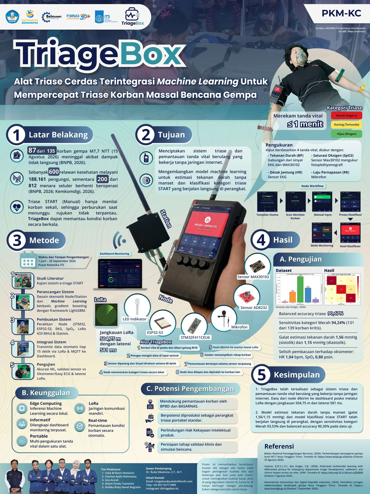
  
TriageBox system architecture and validation poster, awarded 2nd Place (Silver Medal) in Presentation and 3rd Place (Bronze Medal) in Poster (PKM-KC1) at Pekan Ilmiah Mahasiswa Nasional (PIMNAS) 39.

Developed for Program Kreativitas Mahasiswa - Karsa Cipta (PKM-KC), TriageBox is an offline-capable portable triage unit that reduces vital sign acquisition and priority classification to under one minute (57 s waveform capture and 2.53 s on-device inference). Each wearable patient node pairs dual-wavelength photoplethysmography (PPG, Red 660 nm and Infrared 940 nm), single-lead electrocardiography (Lead-I ECG), and an acoustic respiratory sensor with an embedded microcontroller that runs inference locally and transmits priority packets over a 433 MHz LoRa radio link to a base station.

The on-device machine learning pipeline consists of two sequential gradient-boosted decision tree stages based on LightGBM. The first stage extracts 23 cardiovascular pulse-transit, arterial stiffness, and optical perfusion features from synchronized 60 s ECG and PPG waveforms to estimate Systolic Blood Pressure ($\text{SBP}$) and Diastolic Blood Pressure ($\text{DBP}$) without an inflatable cuff. The second stage combines the estimated $\widehat{\text{SBP}}$ with Heart Rate ($\text{HR}$), Respiratory Rate ($\text{RR}$), Oxygen Saturation ($\text{SpO}_2$), age, and biological sex to classify patient acuity under the ESI standard and map the resulting probabilities into START disaster priority colors (Red, Yellow, and Green).

## How it Works

### Cuffless blood pressure regression

Mechanical oscillometric cuffs are slow to inflate, power-intensive, and sensitive to motion artifacts in field trauma settings. To estimate arterial pressure continuously from optical and electrical waveforms, the first stage processes synchronized Lead-I ECG and dual-wavelength finger PPG signals from the [Li et al. (2026)](https://data.mendeley.com/datasets/pz2zzr8vhm/1) dataset (148 subjects, 444 three-minute recordings across seated rest, light-exercise recovery, and moderate-exercise recovery).

Raw sensor streams sampled at $f_{s,\text{raw}} = 240\text{ Hz}$ are segmented into 60 s sliding windows with a 2 s stride ($N_{\text{win}} = 9,387$ windows) and resampled to $f_s = 100\text{ Hz}$ ($N = 6,000$ samples per window) through polyphase FIR filtering with upsampling factor $L = 5$ and decimation factor $M = 12$:

$$
x[n] = \sum_{k} x_{\text{raw}}[k] \, h_{\text{LP}}\!\left(n M - k L\right), \qquad f_s = \frac{L}{M} f_{s,\text{raw}} = \frac{5}{12}(240\text{ Hz}) = 100\text{ Hz}
$$

Let $e[n]$, $p_{\text{IR}}[n]$, and $p_{\text{Red}}[n]$ denote the resampled ECG, infrared PPG (940 nm), and red PPG (660 nm) signals for $n \in \lbrace 0, 1, \dots, N - 1 \rbrace$. Cardiac R-peaks on $e[n]$ are detected using the [Pan and Tompkins (1985)](https://doi.org/10.1109/TBME.1985.325532) transformation, which computes the discrete derivative, squared energy, and a $W_{\text{int}} = 15\text{ samples}$ (150 ms) moving-window average $E_{\text{QRS}}[n]$:

$$
d_e[n] = e[n] - e[n-1], \qquad s_e[n] = d_e^2[n], \qquad E_{\text{QRS}}[n] = \frac{1}{W_{\text{int}}} \sum_{m=0}^{W_{\text{int}}-1} s_e[n - m]
$$

R-peak indices $\lbrace r_1, r_2, \dots, r_K \rbrace$ are extracted from $E_{\text{QRS}}[n]$ using a minimum refractory distance of $\Delta n_{\min} = 30\text{ samples}$ (300 ms, or 200 bpm) and an adaptive prominence threshold $\gamma_{\text{QRS}} = 0.5\,\sigma_{E_{\text{QRS}}}$. Beat-to-beat $\text{RR}$ intervals (in seconds) and mean Heart Rate ($\text{HR}$, in bpm) are then calculated from the median inter-beat interval:

$$
\text{RR}_k = \frac{r_{k} - r_{k-1}}{f_s}, \qquad \overline{\text{RR}} = \operatorname{median}_{k}\!\left(\text{RR}_k\right), \qquad \text{HR} = \frac{60}{\overline{\text{RR}}}
$$

For each optical channel $c \in \lbrace \text{IR}, \text{Red} \rbrace$, the mean-centered AC waveform $\tilde{p}_c[n] = p_c[n] - \bar{p}_c$ is differentiated to obtain the first-derivative Velocity Plethysmogram ($\text{VPG}_c$) and second-derivative Acceleration Plethysmogram ($\text{APG}_c$):

$$
\text{VPG}_c[n] = \frac{\tilde{p}_c[n+1] - \tilde{p}_c[n-1]}{2}, \qquad \text{APG}_c[n] = \text{VPG}_c[n+1] - \text{VPG}_c[n-1]
$$

Within each valid cardiac cycle $[r_k, r_{k+1}]$, three landmarks are located on the infrared PPG wave: the diastolic foot $n_{f,k} = \arg\min \tilde{p}_{\text{IR}}[n]$, the maximum systolic upslope point $n_{d,k} = \arg\max \text{VPG}_{\text{IR}}[n]$, and the systolic peak $n_{p,k} = \arg\max \tilde{p}_{\text{IR}}[n]$. Measuring the delay from the ECG R-peak $r_k$ to each landmark gives three Pulse Arrival Time ($\text{PAT}$, in ms) variants:

$$
\text{PAT}_{f,k} = \frac{n_{f,k} - r_k}{f_s}\times 10^3, \qquad \text{PAT}_{d,k} = \frac{n_{d,k} - r_k}{f_s}\times 10^3, \qquad \text{PAT}_{p,k} = \frac{n_{p,k} - r_k}{f_s}\times 10^3
$$

Because $\text{PAT}$ includes the electromechanical Pre-Ejection Period ($\text{PEP}$) before aortic valve opening and covaries with heart rate, rate-corrected arrival times are formed via the Fridericia cube-root and Framingham linear formulas. An empirical $\text{PEP}$ estimate is also subtracted from $\text{PAT}$ to isolate vascular Pulse Transit Time ($\text{PTT}$):

$$
\text{PAT}_{f,\text{Frid}} = \frac{\overline{\text{PAT}}_f}{\left(\overline{\text{RR}}\right)^{1/3}}, \qquad \text{PAT}_{\star,\text{Fram}} = \overline{\text{PAT}}_\star + 154\left(1 - \overline{\text{RR}}\right), \quad \star \in \lbrace f, d \rbrace
$$

$$
\widehat{\text{PEP}} = 60 + 12\,\overline{\text{RR}}, \qquad \text{PTT}_\star = \overline{\text{PAT}}_\star - \widehat{\text{PEP}}, \quad \star \in \lbrace f, d, p \rbrace
$$

The physical coupling between $\text{PTT}$ and arterial blood pressure $P$ follows the Moens-Korteweg wave speed equation combined with the Hughes exponential elastic modulus $E(P) = E_0 \exp(\alpha P)$:

$$
\text{PWV} = \frac{L_{\text{art}}}{\text{PTT}} = \sqrt{\frac{E(P)\,h_{\text{wall}}}{\rho_{\text{blood}}\,D_{\text{art}}}} \implies P \propto \ln\!\left(\frac{1}{\text{PTT}^2}\right) \approx c_1 \frac{1}{\text{PTT}^2} + c_2 \frac{1}{\text{PTT}} + c_0
$$

To supply this inverse-square relationship directly to the regression trees, six reciprocal and inverse-square stiffness features are included:

$$
\boldsymbol{\phi}_{\text{stiff}} = \left[ \frac{1}{\overline{\text{PAT}}_d}, \; \frac{1}{\overline{\text{PAT}}_d^2}, \; \frac{1}{\overline{\text{PAT}}_p^2}, \; \frac{1}{\text{PTT}_f^2}, \; \frac{1}{\text{PTT}_d^2}, \; \frac{1}{\text{PTT}_p^2} \right]^T
$$

Diastolic pressure depends heavily on peripheral vascular tone, which shapes the dicrotic reflection contour. For each beat $k$ with pulse amplitude $A_k = \tilde{p}_{\text{IR}}[n_{p,k}] - \tilde{p}_{\text{IR}}[n_{f,k}]$, we compute the systolic rise time $T_{\text{sys},k} = (n_{p,k} - n_{f,k})/f_s$, diastolic decay time $T_{\text{dia},k} = (n_{f,k+1} - n_{p,k})/f_s$, systolic-to-diastolic time ratio $k_{\text{val}} = T_{\text{sys},k}/T_{\text{dia},k}$, pulse widths at 75% infrared amplitude ($\text{PW}_{75}$) and 50% red amplitude ($\text{PW}_{\text{Red},50}$), root-mean-square derivative energies ($\text{VPG}_{\text{RMS}}, \text{APG}_{\text{RMS}}$), infrared Perfusion Index ($\text{PI}_{\text{IR}}$), and the dual-wavelength ratio-of-ratios ($\text{AC/DC}_{\text{ratio}}$):

$$
\text{PI}_{\text{IR}} = 100 \times \frac{\operatorname{median}_k(A_{\text{IR},k})}{\lvert \bar{p}_{\text{IR}} \rvert}, \qquad \text{AC/DC}_{\text{ratio}} = \frac{\sigma_{\tilde{p}_{\text{Red}}} / \lvert \bar{p}_{\text{Red}} \rvert}{\sigma_{\tilde{p}_{\text{IR}}} / \lvert \bar{p}_{\text{IR}} \rvert}
$$

Assembling these timing, stiffness, morphological, and sex variables yields a 23-dimensional feature vector $\mathbf{x}_{\text{BP}} \in \mathbb{R}^{23}$, which drives two separate LightGBM regression ensembles ($f_{\text{SBP}}$ and $f_{\text{DBP}}$, bounded at $M \le 100$ trees for embedded flash memory):

$$
\widehat{\text{SBP}} = f_{\text{SBP}}(\mathbf{x}_{\text{BP}}) = \sum_{m=1}^{M_{\text{SBP}}} T_{m,\text{SBP}}(\mathbf{x}_{\text{BP}}), \qquad \widehat{\text{DBP}} = f_{\text{DBP}}(\mathbf{x}_{\text{BP}}) = \sum_{m=1}^{M_{\text{DBP}}} T_{m,\text{DBP}}(\mathbf{x}_{\text{BP}})
$$

The first-stage regression pipeline is summarized in Algorithm 1:

$$
\begin{array}{l}
\hline
\textbf{Algorithm 1: } \text{Cuffless Blood Pressure Feature Extraction and Dual LightGBM Regression} \\
\hline
\textbf{Input: } \text{Raw } 240\text{ Hz waveforms } (e_{\text{raw}}, p_{\text{IR,raw}}, p_{\text{Red,raw}}) \text{ over } 60\text{ s}, \; \text{biological sex } s \in \lbrace 0, 1 \rbrace \\
\textbf{Output: } \text{Estimated arterial pressures } (\widehat{\text{SBP}}, \widehat{\text{DBP}}) \text{ in mmHg} \\
\hline
\begin{array}{rl}
1: & e, p_{\text{IR}}, p_{\text{Red}} \leftarrow \operatorname{PolyphaseResample}(e_{\text{raw}}, p_{\text{IR,raw}}, p_{\text{Red,raw}}, \; L=5, \; M=12) \quad (f_s = 100\text{ Hz}, \; N = 6000) \\
2: & E_{\text{QRS}}[n] \leftarrow \frac{1}{15}\sum_{m=0}^{14} (e[n-m] - e[n-m-1])^2 \\
3: & \lbrace r_k \rbrace_{k=1}^{K} \leftarrow \operatorname{FindPeaks}(E_{\text{QRS}}, \; \Delta n_{\min}=30, \; \gamma_{\text{QRS}}=0.5\sigma_{E_{\text{QRS}}}) \\
4: & \tilde{p}_c \leftarrow p_c - \bar{p}_c, \quad \text{VPG}_c \leftarrow \nabla \tilde{p}_c, \quad \text{APG}_c \leftarrow \nabla^2 \tilde{p}_c \quad \forall c \in \lbrace \text{IR}, \text{Red} \rbrace \\
5: & \textbf{for each } \text{valid beat } k \in \lbrace 1, \dots, K-1 \rbrace \text{ with } 0.35\text{ s} \lt (r_{k+1} - r_k)/f_s \lt 1.6\text{ s} \textbf{ do} \\
6: & \quad \text{Locate PPG valley } n_{f,k}, \text{ max upslope } n_{d,k}, \text{ and systolic peak } n_{p,k} \text{ in } (r_k, r_{k+1}] \\
7: & \quad \text{Compute beat timings } \text{PAT}_{f,k}, \; \text{PAT}_{d,k}, \; \text{PAT}_{p,k} \text{ and widths } \text{PW}_{75,k}, \; \text{PW}_{\text{Red},50,k}, \; T_{\text{sys},k}, \; k_{\text{val},k} \\
8: & \textbf{end for} \\
9: & \text{Compute medians } \overline{\text{RR}}, \; \overline{\text{PAT}}_f, \; \overline{\text{PAT}}_d, \; \overline{\text{PAT}}_p \text{ and } \widehat{\text{PEP}} \leftarrow 60 + 12\overline{\text{RR}}, \quad \text{PTT}_\star \leftarrow \overline{\text{PAT}}_\star - \widehat{\text{PEP}} \\
10: & \text{Evaluate rate-corrected } \text{PAT}_{f,\text{Frid}}, \; \text{PAT}_{\star,\text{Fram}} \text{ and stiffness terms } \lbrace 1/\overline{\text{PAT}}_d, \; 1/\overline{\text{PAT}}_\star^2, \; 1/\text{PTT}_\star^2 \rbrace \\
11: & \text{Compute optical perfusion } \text{PI}_{\text{IR}}, \; \text{AC/DC}_{\text{ratio}}, \text{ and derivative RMS } (\text{VPG}_{\text{IR},\text{RMS}}, \text{APG}_{\text{IR},\text{RMS}}, \text{VPG}_{\text{Red},\text{RMS}}) \\
12: & \mathbf{x}_{\text{BP}} \leftarrow \text{AssembleFeatureVector}(\text{23 physiological biomarkers}, \; s) \\
13: & \widehat{\text{SBP}} \leftarrow \sum_{m=1}^{M_{\text{SBP}}} T_{m,\text{SBP}}(\mathbf{x}_{\text{BP}}), \qquad \widehat{\text{DBP}} \leftarrow \sum_{m=1}^{M_{\text{DBP}}} T_{m,\text{DBP}}(\mathbf{x}_{\text{BP}})
\end{array} \\
\hline
\end{array}
$$

### Multi-class triage classification

Once $\widehat{\text{SBP}}$, $\text{HR}$, $\text{RR}$, and $\text{SpO}_2$ are obtained, the second stage classifies patient acuity. The classifier is trained on the Federated Multimodal Learning (FedMML) Emergency Department Triage dataset ([Imanov and Dulger, 2026](https://ssrn.com/abstract=6282898)), which contains $N = 87,234$ emergency encounters across five ESI levels.

  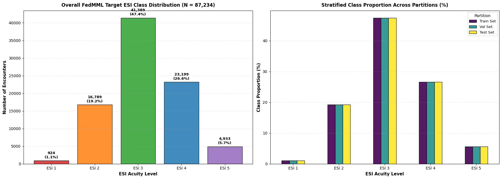
  
Class distribution of the FedMML Emergency Department Triage Dataset ($N = 87{,}234$), showing class imbalance between ESI 1 (1.1%, 924 cases) and ESI 3 (47.4%, 41,389 cases).

Let $\mathbf{x} = [x_{\text{age}}, \; x_{\text{sex}}, \; x_{\text{sbp}}, \; x_{\text{hr}}, \; x_{\text{rr}}, \; x_{\text{spo2}}]^T \in \mathbb{R}^6$ denote the input feature vector, split into five continuous variables $\mathbf{x}_{\text{cont}} \in \mathbb{R}^5$ and binary sex $x_{\text{sex}} \in \lbrace 0, 1 \rbrace$. To prevent preprocessing leakage, the dataset $\mathcal{D}$ is partitioned via a stratified split into 70% training ($\mathcal{D}_{\text{train}}$), 15% validation ($\mathcal{D}_{\text{val}}$), and 15% holdout test ($\mathcal{D}_{\text{test}}$).

Incomplete entries in $\mathbf{x}_{\text{cont}}$ are reconstructed using Multivariate Imputation by Chained Equations (MICE), where each missing feature $x_j$ is estimated iteratively through a ridge regression over the remaining features $\mathbf{x}_{-j}$ fitted only on $\mathcal{D}_{\text{train}}$ across $T_{\text{iter}} = 10$ cycles:

$$
\hat{x}_j^{(t)} = \beta_{0,j}^{(t)} + \left(\boldsymbol{\beta}_j^{(t)}\right)^T \mathbf{x}_{-j}^{(t-1)}, \qquad \left(\beta_{0,j}, \boldsymbol{\beta}_j\right) \text{ fitted on } \mathcal{D}_{\text{train}}
$$

Continuous features are then standardized using the training mean $\boldsymbol{\mu}_{\text{train}}$ and standard deviation $\boldsymbol{\sigma}_{\text{train}}$:

$$
\tilde{x}_j = \frac{\hat{x}_j - \mu_{\text{train},j}}{\sigma_{\text{train},j}}, \qquad j \in \lbrace \text{age}, \text{sbp}, \text{hr}, \text{rr}, \text{spo2} \rbrace
$$

Because critical ESI 1 cases represent 1.1% of all arrivals (924 / 87,234), unweighted cross-entropy loss favors the majority ESI 3 class (47.4%) and causes under-triage of unstable patients. To balance sensitivity across classes, each training sample $i$ of class $y_i \in \lbrace 0, \dots, C-1 \rbrace$ is weighted inversely to its class frequency $N_{y_i}$:

$$
w_i = \frac{N_{\text{train}}}{C \cdot N_{y_i}}, \qquad \mathcal{L}_{\text{weighted}} = -\frac{1}{N_{\text{train}}} \sum_{i=1}^{N_{\text{train}}} w_i \sum_{c=0}^{C-1} \mathbb{I}(y_i = c) \ln p_c(\tilde{\mathbf{x}}_i)
$$

where $p_c(\tilde{\mathbf{x}}_i)$ is the softmax probability over the raw additive tree ensemble logits $z_c(\tilde{\mathbf{x}}_i) = \sum_{m=1}^{M} f_{m,c}(\tilde{\mathbf{x}}_i)$:

$$
p_c(\tilde{\mathbf{x}}_i) = \frac{\exp\!\left(z_c(\tilde{\mathbf{x}}_i)\right)}{\sum_{k=0}^{C-1} \exp\!\left(z_k(\tilde{\mathbf{x}}_i)\right)}
$$

Tree hyperparameters $\boldsymbol{\theta}$ (learning rate, leaf count, maximum depth, minimum child samples, row subsampling, feature subsampling, and $L_1/L_2$ penalties) are tuned via Bayesian optimization with a Tree-structured Parzen Estimator (TPE) to maximize validation Macro Balanced Accuracy:

$$
\boldsymbol{\theta}^\ast = \arg\max_{\boldsymbol{\theta} \in \Theta} \; \text{BalAcc}_{\text{val}}(\boldsymbol{\theta}) = \arg\max_{\boldsymbol{\theta} \in \Theta} \; \frac{1}{C} \sum_{c=0}^{C-1} \frac{\text{TP}_c}{\text{TP}_c + \text{FN}_c}
$$

To compute exact confidence intervals for the Receiver Operating Characteristic Area Under the Curve (AUROC) on the holdout test set without bootstrap resampling, we apply the non-parametric U-statistic method of [DeLong et al. (1988)](https://doi.org/10.2307/2531595). For each One-vs-Rest comparison with $m$ positive samples $\lbrace X_i \rbrace_{i=1}^{m}$ and $n$ negative samples $\lbrace Y_j \rbrace_{j=1}^{n}$, the Mann-Whitney kernel $\psi(X_i, Y_j)$ defines the empirical AUROC $\hat{\theta}_{\text{AUC}}$:

$$
\psi(X_i, Y_j) = \begin{cases} 1, & X_i \gt Y_j \\ 0.5, & X_i = Y_j \\ 0, & X_i \lt Y_j \end{cases}, \qquad \hat{\theta}_{\text{AUC}} = \frac{1}{mn} \sum_{i=1}^{m} \sum_{j=1}^{n} \psi(X_i, Y_j)
$$

Evaluating the structural placement values $V_{10}(X_i) = \frac{1}{n}\sum_{j=1}^{n}\psi(X_i, Y_j)$ and $V_{01}(Y_j) = \frac{1}{m}\sum_{i=1}^{m}\psi(X_i, Y_j)$ gives the DeLong variance $\operatorname{Var}(\hat{\theta}_{\text{AUC}})$ and 95% Wald Confidence Interval:

$$
S_{10} = \frac{1}{m-1}\sum_{i=1}^{m}\left(V_{10}(X_i) - \hat{\theta}_{\text{AUC}}\right)^2, \qquad S_{01} = \frac{1}{n-1}\sum_{j=1}^{n}\left(V_{01}(Y_j) - \hat{\theta}_{\text{AUC}}\right)^2
$$

$$
\operatorname{Var}\!\left(\hat{\theta}_{\text{AUC}}\right) = \frac{S_{10}}{m} + \frac{S_{01}}{n}, \qquad \text{CI}_{95\%} = \hat{\theta}_{\text{AUC}} \pm 1.96\sqrt{\operatorname{Var}\!\left(\hat{\theta}_{\text{AUC}}\right)}
$$

To translate hospital ESI predictions into prehospital START disaster color tags following the multinational Translational Triage Tool (TTT) concordance framework ([Phattharapornjaroen et al., 2026](https://doi.org/10.1038/s41598-026-52015-7)), the 4-class ESI posterior probabilities $(p_{\text{ESI 1}}, p_{\text{ESI 2}}, p_{\text{ESI 3}}, p_{\text{ESI 4}})$ are aggregated into the three START priority tiers:

$$
\mathbf{p}_{\text{START}}(\tilde{\mathbf{x}}) = \begin{bmatrix} P(\text{Red / Immediate}) \\ P(\text{Yellow / Delayed}) \\ P(\text{Green / Minor}) \end{bmatrix} = \begin{bmatrix} p_{\text{ESI 1}}(\tilde{\mathbf{x}}) \\ p_{\text{ESI 2}}(\tilde{\mathbf{x}}) \\ p_{\text{ESI 3}}(\tilde{\mathbf{x}}) + p_{\text{ESI 4}}(\tilde{\mathbf{x}}) \end{bmatrix}
$$

The second-stage classification routine is summarized in Algorithm 2:

$$
\begin{array}{l}
\hline
\textbf{Algorithm 2: } \text{ESI-to-START Triage Classification Pipeline} \\
\hline
\textbf{Input: } \text{Vital vector } \mathbf{x} = [x_{\text{age}}, \; x_{\text{sex}}, \; \widehat{\text{SBP}}, \; \text{HR}, \; \text{RR}, \; \text{SpO}_2]^T, \; \text{MICE weights } \mathbf{B}_{\text{train}}, \; \text{scaler } (\boldsymbol{\mu}_{\text{train}}, \boldsymbol{\sigma}_{\text{train}}) \\
\textbf{Output: } \text{Predicted ESI level } \hat{y}_{\text{ESI}} \in \lbrace 1, 2, 3, 4 \rbrace \text{ and START priority } \hat{y}_{\text{START}} \in \lbrace \text{Red}, \text{Yellow}, \text{Green} \rbrace \\
\hline
\begin{array}{rl}
1: & \mathbf{x}_{\text{cont}} \leftarrow [x_{\text{age}}, \; \widehat{\text{SBP}}, \; \text{HR}, \; \text{RR}, \; \text{SpO}_2]^T \\
2: & \textbf{if } \mathbf{x}_{\text{cont}} \text{ contains missing sensor values } \textbf{then} \\
3: & \quad \hat{\mathbf{x}}_{\text{cont}} \leftarrow \operatorname{IterativeMICEImpute}(\mathbf{x}_{\text{cont}}, \; \mathbf{B}_{\text{train}}, \; T_{\text{iter}}=10) \\
4: & \textbf{else} \\
5: & \quad \hat{\mathbf{x}}_{\text{cont}} \leftarrow \mathbf{x}_{\text{cont}} \\
6: & \textbf{end if} \\
7: & \tilde{\mathbf{x}}_{\text{cont}} \leftarrow (\hat{\mathbf{x}}_{\text{cont}} - \boldsymbol{\mu}_{\text{train}}) / \boldsymbol{\sigma}_{\text{train}}, \qquad \tilde{\mathbf{x}} \leftarrow [\tilde{x}_{\text{age}}, \; x_{\text{sex}}, \; \tilde{x}_{\text{sbp}}, \; \tilde{x}_{\text{hr}}, \; \tilde{x}_{\text{rr}}, \; \tilde{x}_{\text{spo2}}]^T \\
8: & \textbf{for } c = 0 \textbf{ to } 3 \textbf{ do} \quad (\text{ESI levels } 1, 2, 3, 4) \\
9: & \quad z_c \leftarrow \sum_{m=1}^{M} f_{m,c}(\tilde{\mathbf{x}}) \\
10: & \textbf{end for} \\
11: & p_c \leftarrow \exp(z_c) / \sum_{k=0}^{3} \exp(z_k) \quad \forall c \in \lbrace 0, 1, 2, 3 \rbrace \\
12: & \hat{y}_{\text{ESI}} \leftarrow 1 + \arg\max_{c \in \lbrace 0,1,2,3 \rbrace} p_c \\
13: & P(\text{Red}) \leftarrow p_0, \quad P(\text{Yellow}) \leftarrow p_1, \quad P(\text{Green}) \leftarrow p_2 + p_3 \\
14: & \hat{y}_{\text{START}} \leftarrow \arg\max_{k \in \lbrace \text{Red}, \text{Yellow}, \text{Green} \rbrace} P(k)
\end{array} \\
\hline
\end{array}
$$

### Validation against the ESI handbook

To verify that the decision boundaries learned from the training cohort reflect clinical triage standards rather than dataset bias, we compare the empirical feature distributions and split-gain attributions against the Emergency Severity Index (ESI) Handbook, Version 5 (Gilboy et al., 2023).

<table align="center" style="border: none; border-collapse: collapse; margin: 1.5rem auto; width: 100%; max-width: 820px;">
  <tr style="border: none; background: transparent;">
    <td align="center" width="50%" style="border: none; background: transparent; padding: 4px;">
      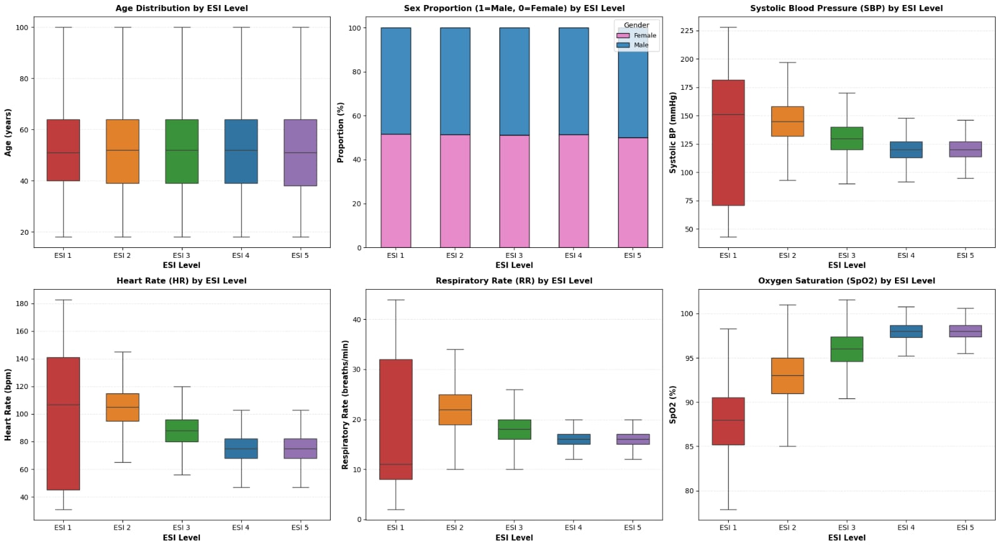
    </td>
    <td align="center" width="50%" style="border: none; background: transparent; padding: 4px;">
      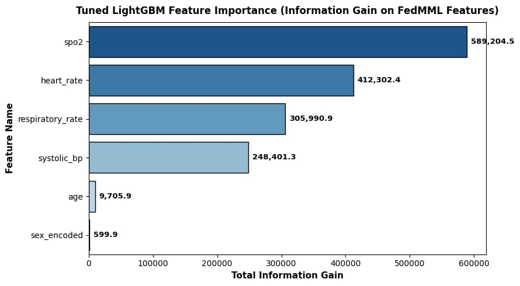
    </td>
  </tr>
  <tr style="border: none; background: transparent;">
    <td align="center" style="border: none; background: transparent; padding: 4px 6px 0; font-size: 0.88rem; color: var(--subtext-color); line-height: 1.4;">
      <b>(a)</b> Boxplot distributions of SBP, HR, RR, and SpO2 across ESI Levels 1–5 ($N = 87{,}234$).
    </td>
    <td align="center" style="border: none; background: transparent; padding: 4px 6px 0; font-size: 0.88rem; color: var(--subtext-color); line-height: 1.4;">
      <b>(b)</b> Total LightGBM split information gain across the six input features.
    </td>
  </tr>
</table>

In Chapter 3 (Decision Point A) of the ESI Handbook, ESI 1 is assigned to patients needing immediate life-saving intervention due to acute hypoxemia ($\text{SpO}_2 \lt 90\%$), hemodynamic shock ($\text{SBP} \lt 90\text{ mmHg}$) or hypertensive crisis, or severe bradycardia and tachycardia. The dataset distributions in Figure (a) match these criteria. The ESI 1 oxygen saturation distribution has a median of 88.0% (IQR: 85.0%–90.5%), sitting below the handbook's 90% resuscitation threshold. Unlike lower-acuity classes that cluster around normal resting values, ESI 1 spans wide two-sided ranges in $\text{SBP}$ (IQR: 70–181 mmHg), $\text{HR}$ (IQR: 45–141 bpm), and $\text{RR}$ (IQR: 8–32 breaths/min), capturing both decompensated shock or pre-arrest bradycardia on the lower tail and hyperacute stress on the upper tail. Because decision trees partition feature space with axis-aligned splits, the ensemble isolates both tails without assuming a monotonic linear trend.

In Chapter 2 (Figure 2-2) and Chapter 6 (Figure 6-1) of the ESI Handbook, Decision Point D specifies the adult (> 18 years) danger-zone vital sign cutoffs that warrant up-triaging a patient to ESI 2:

$$
\text{Adult Danger Zone Thresholds:} \qquad \text{HR} \gt 100\text{ bpm}, \qquad \text{RR} \gt 20\text{ breaths/min}, \qquad \text{SpO}_2 \lt 92\%
$$

The empirical ESI 2 distributions in Figure (a) align directly with Decision Point D. The ESI 2 heart rate median is 105 bpm (IQR: 95–115 bpm), exceeding the 100 bpm cutoff, whereas the ESI 3 median drops back inside normal limits to 88 bpm (IQR: 80–95 bpm). Similarly, the ESI 2 respiratory rate median is 22 breaths/min (IQR: 19–25 breaths/min), above the 20 breaths/min threshold, while ESI 3 returns to 18 breaths/min (IQR: 16–20 breaths/min). For oxygen saturation, the ESI 2 cohort sits at a median of 93% (IQR: 91%–95%), straddling the 92% cutoff, whereas ESI 3 rises to 96% and ESI 4–5 settle at 98%.

| Triage Tier | ESI Handbook v5 Criterion (Ch. 2, 3, 5, 6)                                                | Dataset Distribution (Median [IQR])                                                    | Clinical Alignment                                                                 |
| :---------- | :---------------------------------------------------------------------------------------- | :------------------------------------------------------------------------------------- | :--------------------------------------------------------------------------------- |
| **ESI 1**   | $\text{SpO}_2 \lt 90\%$, shock ($\text{SBP} \lt 90\text{ mmHg}$), arrest or agonal vitals | $\text{SpO}_2$: 88% [85.0–90.5%]; $\text{SBP}$: 125 [70–181]; $\text{HR}$: 95 [45–141] | Captures hypoxemia and two-sided shock/arrest tails                                |
| **ESI 2**   | Adult Danger Zone: $\text{HR} \gt 100$, $\text{RR} \gt 20$, $\text{SpO}_2 \lt 92\%$       | $\text{HR}$: 105 [95–115]; $\text{RR}$: 22 [19–25]; $\text{SpO}_2$: 93% [91–95%]       | Median $\text{HR}$ (105) and $\text{RR}$ (22) match $\gt 100$ and $\gt 20$ cutoffs |
| **ESI 3**   | Vital signs within normal limits (WNL); $\ge 2$ ED resources                              | $\text{HR}$: 88 [80–95]; $\text{RR}$: 18 [16–20]; $\text{SpO}_2$: 96% [95–97%]         | Satisfies $\text{HR} \le 100$, $\text{RR} \le 20$, $\text{SpO}_2 \ge 92\%$         |
| **ESI 4**   | Vital signs WNL; 1 ED resource required                                                   | $\text{HR}$: 75 [68–82]; $\text{RR}$: 16 [15–17]; $\text{SpO}_2$: 98% [97–99%]         | Normotensive resting baseline ($\text{SBP}$: 120 mmHg)                             |
| **ESI 5**   | Vital signs WNL; 0 ED resources required                                                  | $\text{HR}$: 75 [68–82]; $\text{RR}$: 16 [15–17]; $\text{SpO}_2$: 98% [97–99%]         | Identical vital sign distribution to ESI 4                                         |

The split-gain attribution in Figure (b) reinforces this finding. The four cardiopulmonary vital signs account for 99.34% of the total information gain across the tree ensemble ($\text{SpO}_2$: 589,204.5 or 37.62%; $\text{HR}$: 412,302.4 or 26.33%; $\text{RR}$: 305,990.9 or 19.54%; $\text{SBP}$: 248,401.3 or 15.86%), while age (9,705.9 or 0.62%) and sex (599.9 or 0.04%) contribute 0.66%. The model partitions patients using the physiological thresholds defined at Decision Points A and D rather than demographic correlates.

### Why the ESI 5 category was dropped

During development, we evaluated both a 5-class model (ESI 1–5, $N = 87,234$) and a 4-class model (ESI 1–4, $N = 82,301$) that excludes ESI 5. We selected the 4-class formulation for deployment based on the structure of the ESI algorithm and the resulting confusion matrix behavior.

Under Chapter 2 (Figure 2-1) and Chapter 5 (Figure 5-1 and Table 5-1) of the ESI Handbook, vital signs only govern Decision Points A (ESI 1) and D (ESI 2 vs. ESI 3). Once life-threatening instability and high-risk presentations are excluded, patients in ESI 3, ESI 4, and ESI 5 all present with vital signs within normal limits and are separated at Decision Point C by the number of expected hospital Emergency Department resources: $\ge 2$ resources for ESI 3 (such as laboratory bloodwork plus diagnostic imaging), 1 resource for ESI 4 (such as a single X-ray or simple laceration suture), and 0 resources for ESI 5 (physical examination or prescription refill only).

Because an autonomous field sensor only measures physiological waveforms and cannot observe whether a stable patient needs a prescription refill (0 resources) or a single suture (1 resource), separating ESI 4 from ESI 5 from vital signs alone is an ill-posed problem. Figure (a) shows that ESI 4 ($N = 23,199$) and ESI 5 ($N = 4,933$) share identical medians and interquartile ranges across all four vital signs: $\text{SBP} = 120\text{ mmHg}$ (IQR: 113–128), $\text{HR} = 75\text{ bpm}$ (IQR: 68–82), $\text{RR} = 16\text{ breaths/min}$ (IQR: 15–17), and $\text{SpO}_2 = 98\%$ (IQR: 97%–99%).

<table align="center" style="border: none; border-collapse: collapse; margin: 1.5rem auto; width: 100%; max-width: 820px;">
  <tr style="border: none; background: transparent;">
    <td align="center" width="50%" style="border: none; background: transparent; padding: 4px;">
      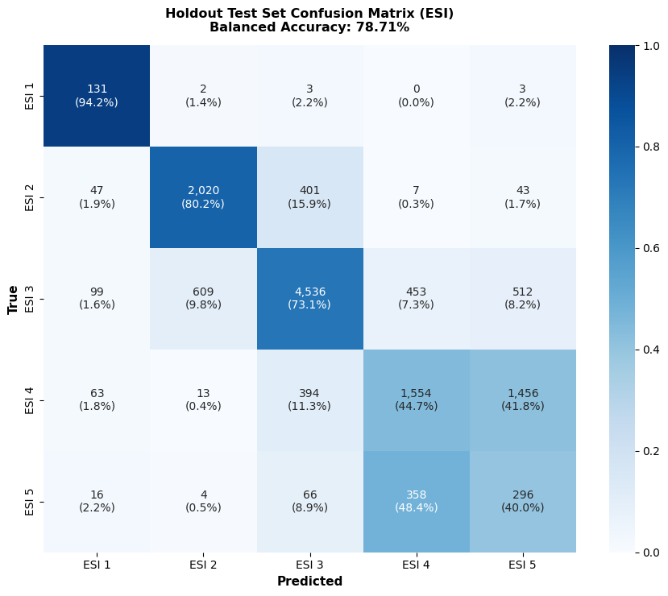
    </td>
    <td align="center" width="50%" style="border: none; background: transparent; padding: 4px;">
      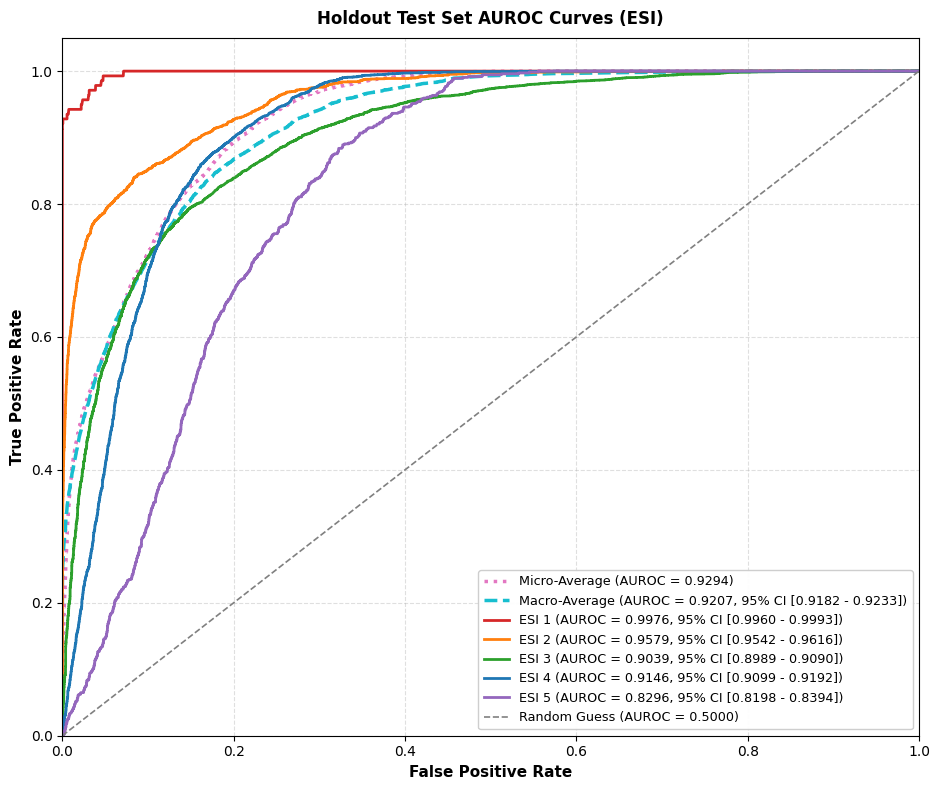
    </td>
  </tr>
  <tr style="border: none; background: transparent;">
    <td colspan="2" align="center" style="border: none; background: transparent; padding: 4px 8px 14px; font-size: 0.88rem; color: var(--subtext-color); line-height: 1.4;">
      <b>5-Class Model (ESI 1–5, $N_{\text{test}} = 13{,}086$):</b> Balanced Accuracy reaches 78.71% (Macro AUROC = 0.9207). Mutual overlap between ESI 4 and ESI 5 causes 41.8% of true ESI 4 cases (1,456 / 3,480) to be predicted as ESI 5, and 48.4% of true ESI 5 cases (358 / 740) to be predicted as ESI 4.
    </td>
  </tr>
  <tr style="border: none; background: transparent;">
    <td align="center" width="50%" style="border: none; background: transparent; padding: 4px;">
      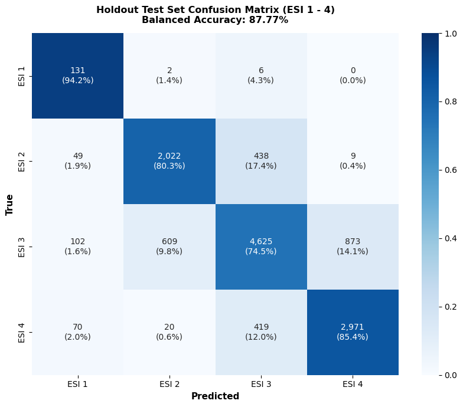
    </td>
    <td align="center" width="50%" style="border: none; background: transparent; padding: 4px;">
      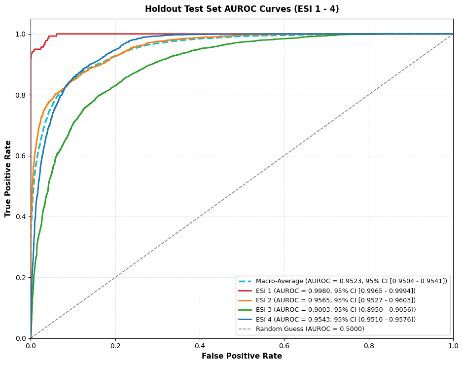
    </td>
  </tr>
  <tr style="border: none; background: transparent;">
    <td colspan="2" align="center" style="border: none; background: transparent; padding: 4px 8px 0; font-size: 0.88rem; color: var(--subtext-color); line-height: 1.4;">
      <b>4-Class Model (ESI 1–4, $N_{\text{test}} = 12{,}346$):</b> Dropping ESI 5 raises Balanced Accuracy to 87.77% (Macro AUROC = 0.9523), while ESI 4 sensitivity increases from 44.66% to 85.37% (2,971 / 3,480).
    </td>
  </tr>
</table>

In the 5-class confusion matrix, inverse-frequency class weighting scales the gradient of the smaller ESI 5 cohort (4,933 cases) by nearly 5× relative to ESI 4 (23,199 cases), forcing the trees to place arbitrary splits across the normotensive cluster. As a result, 41.8% of true ESI 4 patients (1,456 / 3,480) are misclassified as ESI 5, and 48.4% of true ESI 5 patients (358 / 740) are misclassified as ESI 4, holding ESI 4 sensitivity to 44.66%, ESI 5 sensitivity to 40.00%, and overall Balanced Accuracy to 78.71%.

Removing ESI 5 resolves this boundary conflict, increasing ESI 4 sensitivity by +40.71 percentage points (44.66% to 85.37%), ESI 4 AUROC from 0.9146 to 0.9543, and overall Balanced Accuracy from 78.71% to 87.77% (Macro AUROC = 0.9523). Under the prehospital START and Translational Triage Tool mapping ([Phattharapornjaroen et al., 2026](https://doi.org/10.1038/s41598-026-52015-7)), all stable minor patients in ESI 3–5 map to the Green (Minor) tier, so dropping ESI 5 preserves operational resolution while freeing tree capacity for higher-acuity splits.

## Result

### Cuffless blood pressure regression

On the 10% holdout test partition ($N_{\text{test}} = 939$ windows of 60 s duration), the dual LightGBM regressors track reference sphygmomanometer measurements closely and meet the AAMI / ANSI / ISO 81060-2 clinical standard (mean bias within $\pm 5.0\text{ mmHg}$ and error standard deviation $\le 8.0\text{ mmHg}$):

  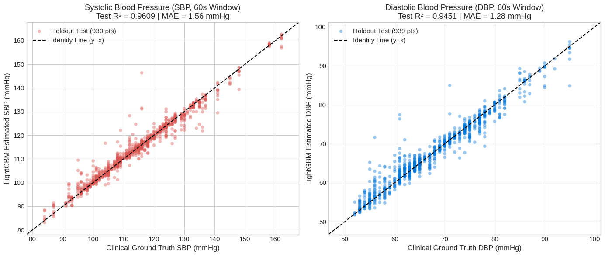
  
Holdout test regression results ($N = 939$ windows, 60 s duration) for Systolic Blood Pressure ($R^2 = 0.9609$, MAE = 1.56 mmHg) and Diastolic Blood Pressure ($R^2 = 0.9451$, MAE = 1.28 mmHg).

| Target              | $R^2$  | MAE (mmHg) | RMSE (mmHg) | Bias (mmHg) | SD (mmHg) | ISO 81060-2 |
| :------------------ | :----: | :--------: | :---------: | :---------: | :-------: | :---------: |
| **Systolic (SBP)**  | 0.9609 |    1.56    |    2.76     |    +0.04    |   2.77    |    Pass     |
| **Diastolic (DBP)** | 0.9451 |    1.28    |    2.14     |    +0.13    |   2.13    |    Pass     |

Compiled to standalone C on the embedded processor, the full 60 s resampling, QRS detection, 23-feature extraction, and dual tree evaluation completes in 2.51 s with numerical deviation below $10^{-9}\text{ mmHg}$ relative to floating-point reference execution.

### Triage classification and START mapping

When the 4-class ESI probabilities are aggregated into the 3-tier START disaster priority scheme ($\text{Red} = \text{ESI 1}$, $\text{Yellow} = \text{ESI 2}$, $\text{Green} = \text{ESI 3-4}$), holdout Balanced Accuracy reaches 90.17% with a Macro AUROC of 0.9714 (95% DeLong CI: [0.9696, 0.9732]) and an on-device inference time of 21.04 ms:

<table align="center" style="border: none; border-collapse: collapse; margin: 1.5rem auto; width: 100%; max-width: 820px;">
  <tr style="border: none; background: transparent;">
    <td align="center" width="50%" style="border: none; background: transparent; padding: 4px;">
      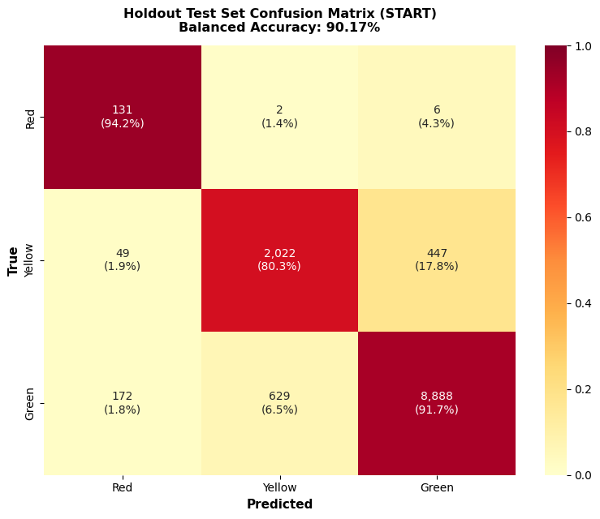
    </td>
    <td align="center" width="50%" style="border: none; background: transparent; padding: 4px;">
      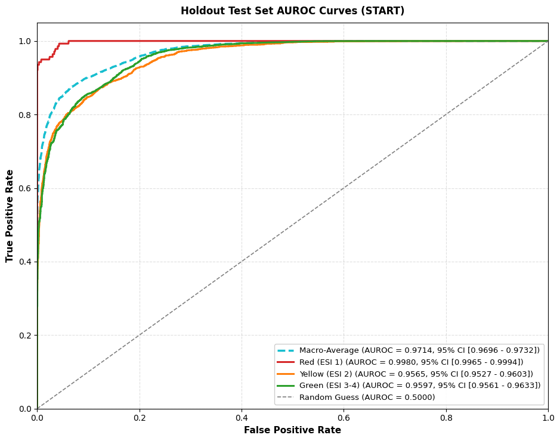
    </td>
  </tr>
  <tr style="border: none; background: transparent;">
    <td colspan="2" align="center" style="border: none; background: transparent; padding: 4px 8px 0; font-size: 0.88rem; color: var(--subtext-color); line-height: 1.4;">
      <b>3-Tier START Triage Evaluation ($N_{\text{test}} = 12{,}346$):</b> Achieves 90.17% Balanced Accuracy and 0.9714 Macro AUROC, identifying 94.24% (131 / 139) of Red (Immediate) casualties with zero Red cases misclassified as Green (AUROCRed = 0.9980).
    </td>
  </tr>
</table>

| Tier / Class | Count| 80.22% | 94.06% | 87.14% | 0.9585 [0.9548, 0.9622] |
| &emsp;ESI 3 (Urgent) | 6,209 | 73.06% | 87.44% | 80.25% | 0.9032 [0.8981, 0.9082] |
| &emsp;ESI 4 (Less Urgent) | 3,480 | 44.66% | 91.48% | 68.07% | 0.9146 [0.9099, 0.9193] |
| &emsp;ESI 5 (Non-Urgent) | 740 | 40.00% | 83.69% | 61.84% | 0.8296 [0.8195, 0.8396] |
| **2. Refined ESI (1–4)** | **12,346** | **83.60%** | **91.94%** | **87.77%** | **0.9523 [0.9504, 0.9541]** |
| &emsp;ESI 1 (Immediate) | 139 | 94.24% | 98.19% | 96.22% | 0.9980 [0.9965, 0.9994] |
| &emsp;ESI 2 (Emergent) | 2,518 | 80.30% | 93.58% | 86.94% | 0.9565 [0.9527, 0.9603] |
| &emsp;ESI 3 (Urgent) | 6,209 | 74.49% | 85.94% | 80.21% | 0.9001 [0.8947, 0.9056] |
| &emsp;ESI 4 (Less Urgent) | 3,480 | 85.37% | 90.05% | 87.71% | 0.9543 [0.9510, 0.9577] |
| **3. Operational START** | **12,346** | **88.76%** | **91.57%** | **90.17%** | **0.9714 [0.9696, 0.9732]** |
| &emsp;Red (Immediate) | 139 | 94.24% | 98.19% | 96.22% | 0.9980 [0.9965, 0.9994] |
| &emsp;Yellow (Delayed) | 2,518 | 80.30% | 93.58% | 86.94% | 0.9565 [0.9527, 0.9603] |
| &emsp;Green (Minor) | 9,689 | 91.73% | 82.95% | 87.34% | 0.9597 [0.9561, 0.9633] |

  
* Model tier header rows report macro-averaged sensitivity, specificity, and balanced accuracy across classes.

### Potential improvements

First, the cuffless blood pressure dataset should be partitioned using subject-wise grouped cross-validation rather than window-level splitting. Because overlapping 60 s windows (2 s stride) from the same person share baseline vascular tone and pulse contour, random window splitting leaks subject-specific morphology across partitions and overstates accuracy on unseen individuals. Training should also be expanded beyond healthy resting and post-exercise subjects (80 to 165 mmHg) to critical-care waveform cohorts (such as MIMIC-III/IV) that cover hemorrhagic shock ($\text{SBP} \lt 70\text{ mmHg}$) and severe trauma.

Second, stage-to-stage uncertainty propagation should be modeled explicitly. The triage classifier is trained on cuff-measured $\text{SBP}$, whereas in field operation it receives the cuffless estimate $\widehat{\text{SBP}}$ from the first stage. Under motion artifacts or hydrostatic pressure shifts when a supine casualty's hand does not rest at heart level, calibration-free $\text{PTT}$ estimates can drift by $\pm 8$ to 15 mmHg. Injecting realistic estimator noise ($\text{SBP} + \epsilon$, $\epsilon \sim \mathcal{N}(0, \sigma_{\text{BP}}^2)$) during classifier training and passing a PPG signal quality index ($\text{SQI}$) into the second stage would prevent noisy blood pressure readings from triggering false splits.

Third, low-burden clinical context and safety-threshold tuning can reduce the remaining overlap between Yellow (ESI 2) and Green (ESI 3). In the 3-tier START evaluation, 19.5% of true Yellow patients (490 / 2,518) are classified as Green. Under Decision Point B of the ESI Handbook (Chapter 4), many ESI 2 patients are triaged as emergent due to altered mental status, severe pain, or high-risk trauma mechanisms while their vital signs remain temporarily compensated within normal limits. Adding an AVPU neurological responsiveness input (_Alert, Verbal, Pain, Unresponsive_) and a compact chief-complaint selector on the node touchscreen, combined with probability threshold tuning on $P(\text{Red})$ and $P(\text{Yellow})$ to enforce American College of Surgeons (ACS-COT) disaster targets (under-triage $\lt 5\%$, over-triage $\le 35\text{-}50\%$), directly addresses this gap.

Fourth, respiratory sensing can be hardened by fusing the acoustic microphone signal with ECG-Derived Respiration (EDR) and PPG-Derived Respiration (PDR). Extracting respiratory rate from R-peak amplitude modulation, respiratory sinus arrhythmia, and PPG baseline wander (0.1–0.5 Hz) provides a backup respiratory channel when ambient noise is high or when an oxygen mask isn't placed on the patient.

Fifth, pediatric age normalization and flat tree-table compression can improve both clinical coverage and firmware footprint. Table 6-1 of the ESI Handbook specifies higher normal heart rate (110–190 bpm) and respiratory rate (30–50 breaths/min) ranges for infants and children; converting raw vitals into age-adjusted $Z$-scores before tree evaluation avoids adult-biased thresholds. On the embedded side, replacing nested `if/else` generated C source code with a flat read-only struct array (`{feature_idx, threshold, left_child, right_child}`) evaluated by a short loop interpreter cuts flash storage from over 4 MB of source code to under 450 KB of constant tables.

## References

N. Gilboy, P. Tanabe, D. Travers, and A. M. Rosenau, _Emergency Severity Index (ESI): A Triage Tool for Emergency Department Care_, Version 5. Schaumburg, IL, USA: Emergency Nurses Association (ENA), 2023.

G. O. Y. L.-F. Lundström-Imanov and S. B. Dulger, "Federated Multimodal Learning for Real-Time Emergency Department Triage Optimization: A Privacy-Preserving Framework Integrating Clinical Notes, Vital Signs, and Laboratory Data," _SSRN Electronic Journal_, 2026. [Online]. Available: [https://ssrn.com/abstract=6282898](https://ssrn.com/abstract=6282898)

P. Phattharapornjaroen _et al._, "A multi-national observational study on the concordance between the translational triage tool and routine prehospital triage," _Scientific Reports_, vol. 16, no. 14645, 2026, doi: [10.1038/s41598-026-52015-7](https://doi.org/10.1038/s41598-026-52015-7).

S. Li, C. Gu, J. Pan, Y. Guo, Z. Di, Q. Tang, and Z. Chen, "A Dataset of Synchronized Raw and Preprocessed Finger-Contact ECG and Dual-Wavelength PPG Signals from Healthy Subjects at Rest and During Seated Post-Exercise Recovery," _Data_, vol. 11, no. 155, 2026. Dataset: [https://data.mendeley.com/datasets/pz2zzr8vhm/1](https://data.mendeley.com/datasets/pz2zzr8vhm/1)

J. Pan and W. J. Tompkins, "A Real-Time QRS Detection Algorithm," _IEEE Transactions on Biomedical Engineering_, vol. BME-32, no. 3, pp. 230–236, Mar. 1985, doi: [10.1109/TBME.1985.325532](https://doi.org/10.1109/TBME.1985.325532).

E. R. DeLong, D. M. DeLong, and D. L. Clarke-Pearson, "Comparing the Areas under Two or More Correlated Receiver Operating Characteristic Curves: A Nonparametric Approach," _Biometrics_, vol. 44, no. 3, pp. 837–845, Sep. 1988, doi: [10.2307/2531595](https://doi.org/10.2307/2531595).

G. Ke _et al._, "LightGBM: A Highly Efficient Gradient Boosting Decision Tree," in _Advances in Neural Information Processing Systems (NeurIPS)_, vol. 30, 2017, pp. 3146–3154.
T. Akiba, S. Sano, T. Yanase, T. Ohta, and M. Koyama, "Optuna: A Next-generation Hyperparameter Optimization Framework," in _Proceedings of the 25th ACM SIGKDD International Conference on Knowledge Discovery & Data Mining_, 2019, pp. 2623–2631.

[Back to Projects](./../projects.md)

[Back to Main](./../../README.md)
