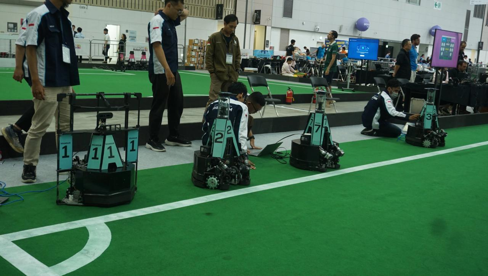

# Multi-Robot Play Strategy for RoboCup Middle Size League

## Introduction

In the RoboCup Middle Size League (MSL), teams of autonomous omnidirectional robots play soccer on a $14\text{ m} \times 22\text{ m}$ pitch without human intervention. A central BaseStation computer only relays referee whistle signals (Kickoff, Free Kick, Corner Kick, Throw-In, or Penalty) over Wi-Fi. Once play begins, the robots coordinate on their own to decide who challenges for the ball, where to pass, and when to shoot.

  
   
  IRIS ITS Middle Size League robots

Four match rules shape our team strategy:

1. **Set-piece standoff**: During an opponent restart, robots must stay at least $2\text{ m}$ from the ball on kickoffs and $3\text{ m}$ on free kicks, corners, goal kicks, and throw-ins until the ball is in play.
2. **Dribbling distance limit**: A robot cannot carry the ball in its dribbler for more than $3\text{ m}$ continuously without releasing it or passing.
3. **Mandatory pass**: With three or more active robots on the pitch, the team must complete at least one pass before scoring a legal goal.
4. **Variable team size**: Robots may leave the field for penalties or repairs, so the strategy adapts automatically whether $1, 2, 3,$ or $4$ outfield robots are playing.

## How it Works

### 1. Unified Multi-Robot Decision Flowchart

The following flowchart combines the tactical decision pipelines of the Attacker, Assist, and Defender across referee set-pieces, open-play possession states, defensive containment, and ball recovery:

```mermaid
flowchart TD
    Start(["Start Team Control Cycle"]) --> CheckRef{"Referee Whistle State?"}

    subgraph SetPieceCoord ["1. Set-Piece Coordination Phase"]
        CheckRef -->|"Home Restart"| HomeSet{"Coordinated Home Setup"}
        CheckRef -->|"Away Restart"| AwaySet{"Coordinated Away Standoff"}

        HomeSet --> SetAst["Assist: Align ball and deliver opening pass"]
        HomeSet --> SetAtt["Attacker: Slew to open forward zone and await pass"]
        HomeSet --> SetDef["Defender: Hold station 1 m outside penalty box"]

        AwaySet --> AwayAtt["Attacker: Hold legal 2 m or 3 m standoff on ball-to-goal path"]
        AwaySet --> AwayAst["Assist: Guard secondary 3.5 to 4 m perimeter against wing passes"]
        AwaySet --> AwayDef["Defender: Track adaptive 3.4 m arc outside penalty box"]
    end

    subgraph OpenPlayDispatch ["2. Open Play Possession Dispatch"]
        CheckRef -->|"Play / Match Running"| PossCheck{"Team Possession State?"}

        PossCheck -->|"Our Team Has Ball"| OurBall{"Which Role Holds Ball?"}
        PossCheck -->|"Opponent Has Ball"| OppBall{"Defensive Layering"}
        PossCheck -->|"Loose / Lost Ball"| LooseBall{"Recovery Situation"}
    end

    subgraph AttackAndDistribution ["3. Possession & Distribution (Our Team Has Ball)"]
        OurBall -->|"Attacker"| AttProg{"Attacker Possession"}
        OurBall -->|"Assist"| AstProg{"Assist Possession"}
        OurBall -->|"Defender"| DefProg{"Defender Possession"}

        AttProg -->|"Clear / Pass / Shoot"| AttAction["Drive within 3 m cap<br/>Pass to Assist if needed<br/>Shoot into empty side of goalpost"]
        AttProg -.->|"Off-Ball Cover"| AstCover["Assist: Drop to y = 5.5 m to cover counter-attacks"]
        AttProg -.->|"Anchor Support"| DefAnchor["Defender: Anchor 1 m outside penalty box edge"]

        AstProg -->|"Playmake / Shoot"| AstAction["Deliver distance-scaled pass to Attacker<br/>Or dribble into attacking half and shoot"]
        AstProg -.->|"Off-Ball Target"| AttEvade["Attacker: Slide out of opponent cone shadow"]

        DefProg -->|"Flank Escape"| DefCheck{"Opponent Near Teammate?"}
        DefCheck -->|"No (Clear Lane)"| DefPass["Pass forward to Attacker to start attack"]
        DefCheck -->|"Yes (Teammate Marked)"| DefClear["Pivot to opponent goalpost and fire clearance punt"]
    end

    subgraph DefensiveContainment ["4. Layered Defensive Structure (Opponent Has Ball)"]
        OppBall --> PressLayer1["1st Line - Attacker: Orientation-aware front press<br/>Circle around ball-shielding opponents at 2.3 m"]
        OppBall --> PressLayer2["2nd Line - Assist: Midfield containment barrier<br/>Hold 3 m buffer behind ball along goal line"]
        OppBall --> PressLayer3["3rd Line - Defender: Penalty-line shot blocking<br/>Slide along y = 3 m and clamp lateral travel to box edges"]
    end

    subgraph LooseBallRecovery ["5. Loose Ball Recovery & Roaming"]
        LooseBall -->|"Fast Moving"| RecovAst["Assist: Predictive intercept ahead of ball trajectory"]
        LooseBall -->|"Near Boundary"| RecovAtt["Attacker: Boundary-safe loop to gather ball inward"]
        LooseBall -->|"Lost Sight / Roam"| RecovTeam["Attacker/Assist: Search last coordinates and patrol zones<br/>Defender: Hold central station outside penalty box"]
    end
```

### 2. Role Specialization

Rather than having every robot chase the ball, the system assigns each outfield robot a distinct tactical role that shares telemetry with the team:

| Role         | Primary Responsibility                                                                    | Detailed Article                                      |
| :----------- | :---------------------------------------------------------------------------------------- | :---------------------------------------------------- |
| **Attacker** | Striker: presses ball carriers, receives forward passes, and finishes on goal             | [Attacker Play Strategy](./attacker_play_strategy.md) |
| **Assist**   | Playmaker: takes set-piece restarts, opens passing lanes, and covers counter-attacks      | [Assist Play Strategy](./assist_play_strategy.md)     |
| **Defender** | Penalty-box anchor: blocks shooting lanes in front of our goal and clears recovered balls | [Defender Play Strategy](./defender_play_strategy.md) |

---

### 3. Three-Phase Match Flow

To handle referee stoppages and open play cleanly, every robot structures its decisions into three sequential phases:

#### Phase 1: Set-Piece Preparation (Before the Whistle)

When the referee calls a stoppage, the BaseStation indicates whether the restart belongs to our team (Home) or the opponent (Away). The robots release the ball if holding it and move to their restart spots using obstacle avoidance. They set up to receive a pass on Home restarts, or retreat behind the standoff line on Away restarts.

#### Phase 2: Set-Piece Opening (First Action After the Whistle)

When the referee signals `Start`, the robots run an opening play before entering open play:

- **Home Restarts**: Assist approaches the ball and passes to Attacker. This opening pass satisfies the mandatory pass rule right away, freeing Attacker to shoot when a lane opens.
- **Away Restarts**: The robots orbit the ball at the required standoff distance ($2\text{ m}$ or $3\text{ m}$), staying between the ball and our goal to block direct shots. Once the opponent touches the ball or the restart timer expires, the robots break from the standoff ring into open play.

#### Phase 3: Dynamic Open Play

After the opening action, each robot tracks who controls the ball and enters one of five open-play states:

| Open-Play State       | Field Situation                      | Team Response                                                                                                |
| :-------------------- | :----------------------------------- | :----------------------------------------------------------------------------------------------------------- |
| **Has Ball**          | Robot holds the ball in its dribbler | Clear the touchline, check if a pass is required, dribble toward goal within $3\text{ m}$, and shoot or pass |
| **Teammate Has Ball** | Teammate controls the ball           | Move into an open lane if the team still needs a pass; otherwise spread wide or cover counter-attacks        |
| **Opponent Has Ball** | Opponent controls the ball           | Nearest robot presses from the front while teammates shadow the goal lane behind the press                   |
| **Loose Ball**        | Ball is free on the pitch            | The designated zonal robot captures the ball while teammates hold support positions                          |
| **Roaming**           | Cameras lose the ball                | Search the last known ball coordinate, then patrol assigned zones until sight is restored                    |

---

### 4. Cooperative Passing Handshake

Passing between moving robots requires tight coordination so the receiver does not turn away as the ball is kicked. Instead of relying on a centralized planner, the robots use a decentralized two-way status handshake:

1. **Lane Check**: When the ball carrier needs to pass, it checks whether the straight corridor to its teammate is clear of opponents and at least $2\text{ m}$ long.
2. **Pass Signal**: The passer pivots toward the teammate and broadcasts an incoming pass flag over the team network.
3. **Receiver Lock**: When the receiver detects the pass signal, it pauses its open-play patrol, turns toward the passer, and tracks the rolling ball into its dribbler.
4. **Unlocking Shots**: Once the receiver catches the ball, the team's pass counter increments, and both robots return to open play with shooting rights unlocked.

## Role-Specific Strategy Breakdowns

Detailed breakdowns for each role:

- [Attacker Play Strategy](./attacker_play_strategy.md): Striker dribbling under the $3\text{ m}$ limit, front-facing pressing, and vision-guided finishing.
- [Assist Play Strategy](./assist_play_strategy.md): Set-piece restarts, distance-scaled passing, ball interception, and defensive recovery.
- [Defender Play Strategy](./defender_play_strategy.md): Penalty-box shot blocking, variable standoff arcs, and counter-attack clearance.

[Back to Projects](./../projects.md)

[Back to Main](./../../README.md)
