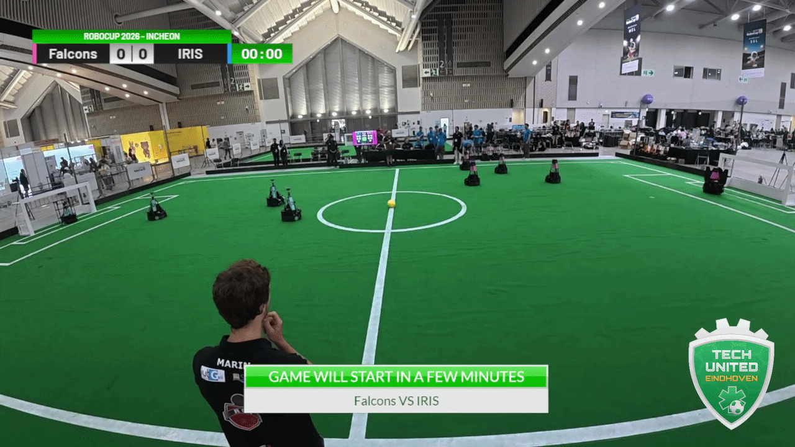
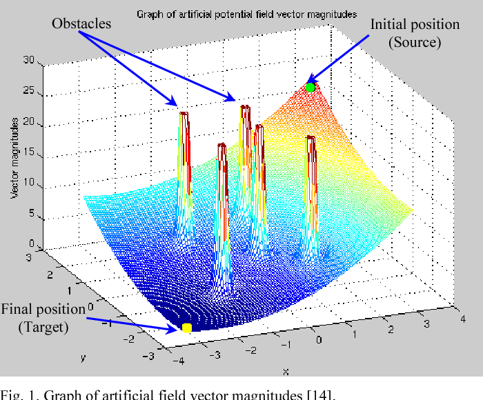
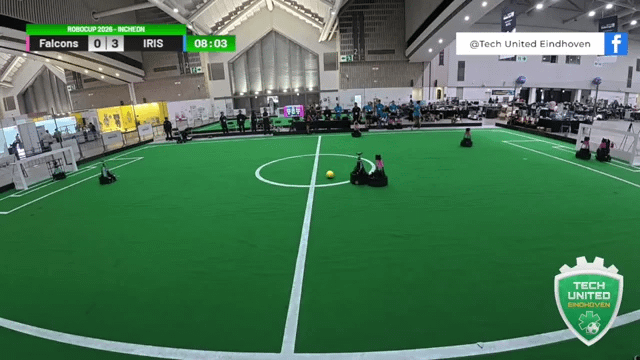
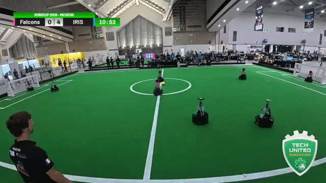

# Artificial Potential Field Based Obstacle Avoidance with Dynamic Acceleration Control

## Introduction

  
   
  Example of robot motion

In the RoboCup Middle Size League (MSL), robots must traverse the field at high speed without colliding with other robots or the ball. Global path planners can route around obstacles on paper, yet tracking a rapidly updating path at match speed breaks down when chassis acceleration is poorly regulated. A low acceleration cap leaves the robot too sluggish to dodge sudden path changes, while an unconstrained acceleration limit causes high-center-of-gravity robots to tip over during sharp velocity reversals.

This controller pairs a discrete Artificial Potential Field (APF) grid planner with reactive sector avoidance. Rather than relying on point-to-point avoidance alone, the APF evaluates a moving world-frame grid around the robot to pick a minimum-potential waypoint and feeds it into the local controller.

  
   
  Example of generated Artificial Potential Field map 

The reactive stage deflects velocity vectors around immediate obstacles and scales speed by nearest-obstacle clearance, while a polar acceleration limiter bounds per-cycle body velocity steps before driving the wheels.

## How it Works

Let $[x_R, y_R, \theta_R]^T$ denote the robot's current pose and $[x_T, y_T, \theta_T]^T$ denote the target pose in the global field coordinate frame:

$$
\mathbf{p}_R = \begin{bmatrix} x_R \\ y_R \\ \theta_R \end{bmatrix}, \hspace{1cm} \mathbf{p}_T = \begin{bmatrix} x_T \\ y_T \\ \theta_T \end{bmatrix}
$$

Let $\mathcal{O} = \lbrace O_1, O_2, \dots, O_K \rbrace$ be the active obstacle set in global coordinates, where each obstacle $O_j = [x_{\text{obs},j}, y_{\text{obs},j}]^T$ is collected from vision-detected field obstacles and optionally includes active teammates and the ball depending on the motion flags. The Euclidean distance from the robot to the global target is:

$$
d_T = \sqrt{(x_T - x_R)^2 + (y_T - y_R)^2}
$$

Around the robot's global position $[x_R, y_R]^T$, the planner defines a rectangular Region of Interest (ROI) of width $W = 800\text{ cm}$ and height $H = 800\text{ cm}$, discretized into an $N_x \times N_y$ ($10 \times 10$) grid of $N_g = N_x N_y$ virtual candidate points. With grid spacing $\Delta x = W / N_x$ and $\Delta y = H / N_y$, the ROI bounds are $x_{\min} = x_R - W/2$ and $y_{\max} = y_R + H/2$. Each linear index $i \in \lbrace 0, 1, \dots, N_g - 1 \rbrace$ maps to 2D grid indices $(i_x, i_y) = (i \bmod N_x, \; \lfloor i / N_x \rfloor)$ and world-frame coordinates $P_i$:

$$
P_i = \begin{bmatrix} x_i \\ y_i \end{bmatrix} = \begin{bmatrix} x_{\min} + \left(i_x + \dfrac{1}{2}\right)\Delta x \\ \rule{0pt}{1.8em} y_{\max} - \left(i_y + \dfrac{1}{2}\right)\Delta y \end{bmatrix}
$$

When the robot is already close to the goal ($d_T < d_{\min}$) or the obstacle set $\mathcal{O}$ is empty, grid evaluation is bypassed and the intermediate sub-goal $P^\ast = [x^\ast, y^\ast]^T$ defaults directly to $[x_T, y_T]^T$ so the robot settles onto the final target without $80\text{ cm}$ grid quantization error.

Otherwise, each candidate point $P_i$ is scored on an artificial potential surface following the formulation described by [Temizer (2001)](https://people.csail.mit.edu/lpk/mars/temizer_2001/Potential_Field_Method/index.html#Complete%20Formula). The global target forms a quadratic attractive basin $U_{\text{att}}(P_i)$ with attraction gain $k_{\text{att}}$:

$$
U_{\text{att}}(P_i) = \dfrac{1}{2} k_{\text{att}} \left(\left(x_i - x_T\right)^2 + \left(y_i - y_T\right)^2\right)
$$

For obstacle repulsion, let $\rho(P_i)$ denote the shortest Euclidean distance from virtual point $P_i$ to any obstacle $O_j \in \mathcal{O}$:

$$
\rho(P_i) = \min_{O_j \in \mathcal{O}} \sqrt{\left(x_i - x_{\text{obs},j}\right)^2 + \left(y_i - y_{\text{obs},j}\right)^2}
$$

Obstacles closer than the influence threshold $\rho_0$ generate an inverse-distance repulsive barrier with gain $k_{\text{rep}}$, while obstacles beyond $\rho_0$ contribute zero potential:

$$
U_{\text{rep}}(P_i) = \begin{cases} \dfrac{1}{2} k_{\text{rep}} \left(\dfrac{1}{\rho(P_i)} - \dfrac{1}{\rho_0}\right)^2, & \rho(P_i) < \rho_0 \\ \rule{0pt}{1.5em} 0, & \rho(P_i) \ge \rho_0 \end{cases}
$$

Superimposing both potentials yields total potential $U(P_i)$, and the virtual point with minimum total potential is selected as the intermediate waypoint $P^\ast$:

$$
U(P_i) = U_{\text{att}}(P_i) + U_{\text{rep}}(P_i), \qquad P^\ast = \begin{bmatrix} x^\ast \\ y^\ast \end{bmatrix} = \arg\min_{P_i} U(P_i)
$$

Tracking $P^\ast$ with an unguarded PID controller can still clip obstacles positioned between $80\text{ cm}$ grid centers or react late to moving opponents inside a cell. Reactive point-to-point avoidance on its own only inspects the forward sector and traps the robot behind concave obstacle groups. Passing the minimum-potential waypoint $P^\ast$ into the point-to-point motion controller with reactive sector avoidance active merges wide potential-valley routing with continuous close-range collision avoidance.

Relative to the selected sub-goal $P^\ast = [x^\ast, y^\ast]^T$ and target heading $\theta_T$, the controller computes Euclidean distance error $e_d$ and wrapped angular error $e_\theta \in [-180^\circ, 180^\circ]$:

$$
e_d = \sqrt{(x^\ast - x_R)^2 + (y^\ast - y_R)^2}, \qquad e_\theta = \operatorname{wrap}\left(\theta_T - \theta_R\right)
$$

Two independent PID loops bounded by $v_{\max}$ and $\omega_{\max}$ map $e_d$ and $e_\theta$ into commanded speed $v_{\text{pid}}$ and angular rate $\omega_l$. Projecting $v_{\text{pid}}$ along the sub-goal bearing $\phi^\ast = \operatorname{atan2}(y^\ast - y_R, \; x^\ast - x_R)$ produces the APF-guided nominal global velocity $[v_{\text{apf},x}, v_{\text{apf},y}]^T$:

$$
\mathbf{v}_{\text{apf}} = \begin{bmatrix} v_{\text{apf},x} \\ v_{\text{apf},y} \end{bmatrix} = v_{\text{pid}} \begin{bmatrix} \cos(\phi^\ast) \\ \sin(\phi^\ast) \end{bmatrix}
$$

The local reactive stage then checks a $\pm 90^\circ$ sector centered on $\phi^\ast$ within a velocity-scaled lookahead radius:

$$
r_{\text{avoid}} = \lvert v_{\text{pid}} \rvert
$$

Scaling $r_{\text{avoid}}$ with $\lvert v_{\text{pid}} \rvert$ expands lookahead distance during high-speed sprints and contracts it near the goal. When an obstacle is detected inside this sector at nearest distance $d_{\text{obs}} < r_{\text{avoid}}$ and global bearing $\theta_{\text{obs}}$, translational speed $v_{\text{avoid}}$ is clamped by $d_{\text{obs}}$ whenever nominal speed $v_{\text{nom}} = \sqrt{v_{\text{apf},x}^2 + v_{\text{apf},y}^2}$ exceeds $v_{\text{safe}}$:

$$
v_{\text{avoid}} = \begin{cases} \min\!\left(v_{\text{nom}}, \; \max(d_{\text{obs}}, v_{\text{safe}})\right), & v_{\text{nom}} > v_{\text{safe}} \\ \rule{0pt}{1.4em} v_{\text{nom}}, & v_{\text{nom}} \le v_{\text{safe}} \end{cases}
$$

Let $\Delta\phi = \operatorname{wrap}(\phi^\ast - \theta_{\text{obs}})$ be the wrapped angle between the APF sub-goal heading and the obstacle bearing. To steer around the shorter side of the obstacle, the global velocity vector deflects tangentially by $-90^\circ$ from $\theta_{\text{obs}}$ when $\Delta\phi < 0$ (obstacle on the left) and by $+90^\circ$ when $\Delta\phi \ge 0$ (obstacle on the right). If the robot's actual global velocity heading remains within $30^\circ$ of $\theta_{\text{obs}}$ at close range across consecutive ticks, a short head-on braking phase reverses the velocity along $\theta_{\text{obs}} - 180^\circ$ at $2 v_{\text{avoid}}$ before returning to tangential bypass:

$$
\mathbf{v}_g = \begin{bmatrix} v_{gx} \\ v_{gy} \end{bmatrix} = \begin{cases} 2 v_{\text{avoid}} \begin{bmatrix} \cos(\theta_{\text{obs}} - 180^\circ) \\ \sin(\theta_{\text{obs}} - 180^\circ) \end{bmatrix}, & \text{head-on braking active} \\ \rule{0pt}{2.2em} v_{\text{avoid}} \begin{bmatrix} \cos(\theta_{\text{obs}} - 90^\circ) \\ \sin(\theta_{\text{obs}} - 90^\circ) \end{bmatrix}, & d_{\text{obs}} < r_{\text{avoid}} \text{ and } \Delta\phi < 0 \\ \rule{0pt}{2.2em} v_{\text{avoid}} \begin{bmatrix} \cos(\theta_{\text{obs}} + 90^\circ) \\ \sin(\theta_{\text{obs}} + 90^\circ) \end{bmatrix}, & d_{\text{obs}} < r_{\text{avoid}} \text{ and } \Delta\phi \ge 0 \\ \rule{0pt}{1.8em} \mathbf{v}_{\text{apf}}, & \text{sector clear} \end{cases}
$$

Rotating the obstacle-adjusted global velocity $[v_{gx}, v_{gy}]^T$ into the robot body coordinate frame by current heading $\theta_R$ yields $[v_{lx}, v_{ly}]^T$:

$$
\begin{bmatrix} v_{lx} \\ v_{ly} \end{bmatrix} = \begin{bmatrix} \sin(\theta_R) & -\cos(\theta_R) \\ \cos(\theta_R) & \sin(\theta_R) \end{bmatrix} \begin{bmatrix} v_{gx} \\ v_{gy} \end{bmatrix}
$$

Discrete switches in $P^\ast$ across grid cells or $\pm 90^\circ$ reactive deflections in $[v_{gx}, v_{gy}]^T$ create sharp step changes in $[v_{lx}, v_{ly}]^T$. Sending unbuffered velocity steps directly to the wheel drives risks tipping the robot. Let $[v_{\text{buf},x}, v_{\text{buf},y}, \omega_{\text{buf}}]^T$ be the buffered body velocity from the previous cycle. After applying hardware calibration scaling, the requested linear velocity increment is expressed in polar form $(\Delta v, \beta)$:

$$
\Delta v = \sqrt{\left(v_{lx} - v_{\text{buf},x}\right)^2 + \left(v_{ly} - v_{\text{buf},y}\right)^2}, \qquad \beta = \operatorname{atan2}\left(v_{ly} - v_{\text{buf},y}, \; v_{lx} - v_{\text{buf},x}\right)
$$

Clamping $\Delta v$ in polar coordinates preserves the exact avoidance direction $\beta$ while bounding net chassis acceleration. Both the translational step limit $a_{\text{lim}}$ and angular step limit $\Delta\omega_{\max}$ tighten automatically when the robot carries the ball:

$$
\Delta v_{\text{lim}} = \min(\Delta v, \; a_{\text{lim}}), \qquad \Delta\omega_{\text{lim}} = \operatorname{clamp}\left(\omega_l - \omega_{\text{buf}}, \; -\Delta\omega_{\max}, \; \Delta\omega_{\max}\right)
$$

Advancing the velocity buffer produces the actuated body velocity vector $[v_{\text{act},x}, v_{\text{act},y}, \omega_{\text{act}}]^T$ passed to the 3-wheeled omnidirectional inverse kinematics model:

$$
\boldsymbol{q}_l = \begin{bmatrix} v_{\text{act},x} \\ v_{\text{act},y} \\ \omega_{\text{act}} \end{bmatrix} = \begin{bmatrix} v_{\text{buf},x} + \Delta v_{\text{lim}}\cos(\beta) \\ v_{\text{buf},y} + \Delta v_{\text{lim}}\sin(\beta) \\ \omega_{\text{buf}} + \Delta\omega_{\text{lim}} \end{bmatrix}
$$

The combined APF and reactive obstacle avoidance control loop is summarized in Algorithm 1:

$$
\begin{array}{l}
\hline
\textbf{Algorithm 1: } \text{Combined APF Global Routing and Reactive Obstacle Avoidance} \\
\hline
\textbf{Input: } \mathbf{p}_R, \; \mathbf{p}_T, \; \mathcal{O}, \; (W, H, N_x, N_y), \; (k_{\text{att}}, k_{\text{rep}}, \rho_0, d_{\min}), \; (v_{\max}, \omega_{\max}, v_{\text{safe}}, a_{\text{lim}}, \Delta\omega_{\max}) \\
\textbf{Output: } \boldsymbol{q}_l = [v_{\text{act},x}, v_{\text{act},y}, \omega_{\text{act}}]^T \text{ (Acceleration-limited body velocity command)} \\
\hline
\begin{array}{rl}
1: & d_T \leftarrow \sqrt{(x_T - x_R)^2 + (y_T - y_R)^2} \\
2: & \textbf{if } d_T < d_{\min} \textbf{ or } \mathcal{O} = \emptyset \textbf{ then} \\
3: & \quad P^\ast \leftarrow [x_T, y_T]^T \\
4: & \textbf{else} \\
5: & \quad \Delta x \leftarrow W / N_x, \quad \Delta y \leftarrow H / N_y, \quad x_{\min} \leftarrow x_R - W / 2, \quad y_{\max} \leftarrow y_R + H / 2 \\
6: & \quad U_{\min} \leftarrow \infty, \quad P^\ast \leftarrow [x_T, y_T]^T \\
7: & \quad \textbf{for } i = 0 \textbf{ to } N_x N_y - 1 \textbf{ do} \\
8: & \quad\quad i_x \leftarrow i \bmod N_x, \quad i_y \leftarrow \lfloor i / N_x \rfloor \\
9: & \quad\quad P_i \leftarrow \left[x_{\min} + (i_x + 0.5)\Delta x, \; y_{\max} - (i_y + 0.5)\Delta y\right]^T \\
10: & \quad\quad U_{\text{att}} \leftarrow \frac{1}{2} k_{\text{att}} \|P_i - [x_T, y_T]^T\|_2^2 \\
11: & \quad\quad \rho_i \leftarrow \min_{O_j \in \mathcal{O}} \|P_i - O_j\|_2 \\
12: & \quad\quad U_{\text{rep}} \leftarrow \frac{1}{2} k_{\text{rep}} (1/\rho_i - 1/\rho_0)^2 \text{ if } \rho_i < \rho_0 \text{ else } 0 \\
13: & \quad\quad \textbf{if } U_{\text{att}} + U_{\text{rep}} < U_{\min} \textbf{ then } U_{\min} \leftarrow U_{\text{att}} + U_{\text{rep}}, \; P^\ast \leftarrow P_i \textbf{ end if} \\
14: & \quad \textbf{end for} \\
15: & \textbf{end if} \\
16: & e_d \leftarrow \|P^\ast - [x_R, y_R]^T\|_2, \quad e_\theta \leftarrow \operatorname{wrap}(\theta_T - \theta_R), \quad \phi^\ast \leftarrow \operatorname{atan2}(y^\ast - y_R, x^\ast - x_R) \\
17: & v_{\text{pid}} \leftarrow \operatorname{PID}_{\text{lin}}(e_d, v_{\max}), \quad \omega_l \leftarrow \operatorname{PID}_{\text{ang}}(e_\theta, \omega_{\max}) \\
18: & \mathbf{v}_{\text{apf}} \leftarrow v_{\text{pid}} [\cos\phi^\ast, \sin\phi^\ast]^T, \quad r_{\text{avoid}} \leftarrow \lvert v_{\text{pid}} \rvert \\
19: & (d_{\text{obs}}, \theta_{\text{obs}}, \text{hit}) \leftarrow \text{SectorObstacleCheck}(\mathcal{O}, \phi^\ast, \pm 90^\circ, r_{\text{avoid}}) \\
20: & \textbf{if } \text{hit} \textbf{ then} \\
21: & \quad v_{\text{avoid}} \leftarrow \min\!\left(\|\mathbf{v}_{\text{apf}}\|_2, \max(d_{\text{obs}}, v_{\text{safe}})\right) \text{ if } \|\mathbf{v}_{\text{apf}}\|_2 > v_{\text{safe}} \text{ else } \|\mathbf{v}_{\text{apf}}\|_2 \\
22: & \quad \textbf{if } \text{head-on collision imminent } \textbf{ then} \\
23: & \quad\quad \mathbf{v}_g \leftarrow 2 v_{\text{avoid}} [\cos(\theta_{\text{obs}} - 180^\circ), \; \sin(\theta_{\text{obs}} - 180^\circ)]^T \\
24: & \quad \textbf{else} \\
25: & \quad\quad \Delta\phi \leftarrow \operatorname{wrap}(\phi^\ast - \theta_{\text{obs}}), \quad \sigma \leftarrow -90^\circ \text{ if } \Delta\phi < 0 \text{ else } +90^\circ \\
26: & \quad\quad \mathbf{v}_g \leftarrow v_{\text{avoid}} [\cos(\theta_{\text{obs}} + \sigma), \; \sin(\theta_{\text{obs}} + \sigma)]^T \\
27: & \quad \textbf{end if} \\
28: & \textbf{else} \\
29: & \quad \mathbf{v}_g \leftarrow \mathbf{v}_{\text{apf}} \\
30: & \textbf{end if} \\
31: & [v_{lx}, v_{ly}]^T \leftarrow [v_{gx}\sin\theta_R - v_{gy}\cos\theta_R, \; v_{gx}\cos\theta_R + v_{gy}\sin\theta_R]^T \\
32: & \Delta\mathbf{v}_l \leftarrow [v_{lx} - v_{\text{buf},x}, \; v_{ly} - v_{\text{buf},y}]^T, \quad \beta \leftarrow \operatorname{atan2}(\Delta v_{ly}, \Delta v_{lx}) \\
33: & \Delta v_{\text{lim}} \leftarrow \min(\|\Delta\mathbf{v}_l\|_2, \; a_{\text{lim}}), \quad \Delta\omega_{\text{lim}} \leftarrow \operatorname{clamp}(\omega_l - \omega_{\text{buf}}, -\Delta\omega_{\max}, \Delta\omega_{\max}) \\
34: & \boldsymbol{q}_l \leftarrow [v_{\text{buf},x} + \Delta v_{\text{lim}}\cos\beta, \; v_{\text{buf},y} + \Delta v_{\text{lim}}\sin\beta, \; \omega_{\text{buf}} + \Delta\omega_{\text{lim}}]^T \\
35: & \text{UpdateVelocityBuffer}(\boldsymbol{q}_l), \quad \text{ActuateOmnidirectionalBase}(\boldsymbol{q}_l)
\end{array} \\
\hline
\end{array}
$$

## Result

<table align="center">
  <tr>
    <td align="center">
      
    </td>
    <td align="center">
      
    </td>
  </tr>
  <tr>
    <td colspan="2" align="center">
      Obstacle avoidance result (cyan for IRIS ITS robots).
    </td>
  </tr>
</table>

## References

S. Temizer, "Potential Field Method Formula: Step by Step Construction of the Formula," MIT Artificial Intelligence Laboratory, Mobile Autonomous Robot Software (MARS) Project, 2001. [Online]. Available: [https://people.csail.mit.edu/lpk/mars/temizer_2001/Potential_Field_Method/index.html#Complete%20Formula](https://people.csail.mit.edu/lpk/mars/temizer_2001/Potential_Field_Method/index.html#Complete%20Formula)

## Source

Coming Soon

[Back to Projects](./../projects.md)

[Back to Main](./../../README.md)
