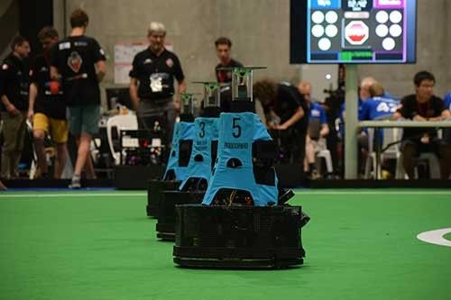
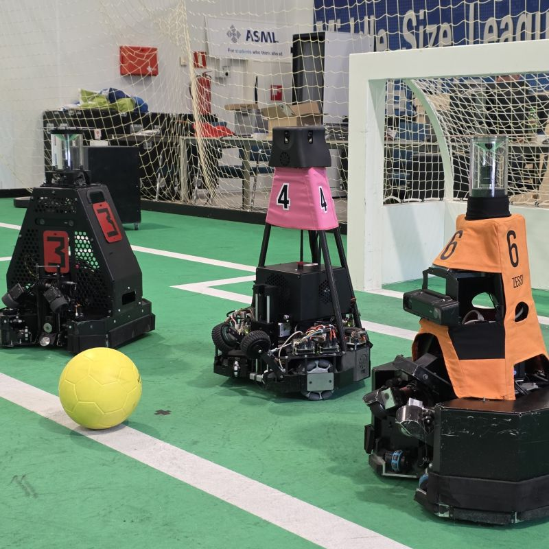
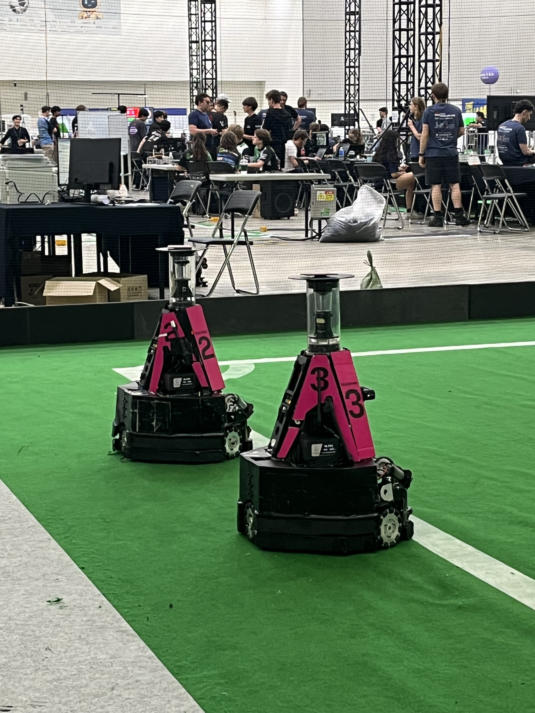
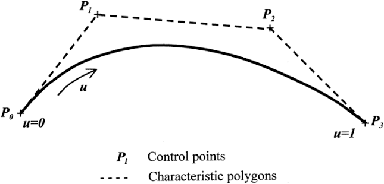
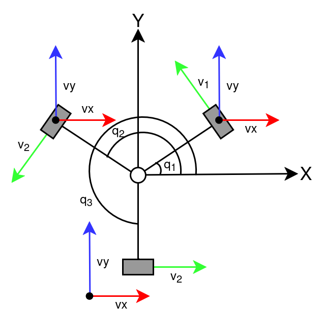

# Differential Drive-like Motion on Omnidirectional Robot with 3rd-Order Bézier Curve Path Planning

## Introduction

In the RoboCup Middle Size League (MSL), the most popular wheel configuration is the 3-wheeled omnidirectional system.

<table align="center">
  <tr>
    <td align="center">
      
    </td>
    <td align="center">
      
    </td>
    <td align="center">
      
    </td>
  </tr>
  <tr>
    <td colspan="3" align="center">
      Examples of 3-wheeled omnidirectional robots from RoboCup MSL teams (Tech United Eindhoven, Falcons, IRIS).
    </td>
  </tr>
</table>

The main advantage of this system is that it allows the robot to move translationally in any direction while rotating freely at the same time. Even though the system has such a huge advantage, relying purely on this system can increase the difficulty of Natural Dribbling. Since the robot can move in any direction and orientation at the same time, this requires the dribbled ball to follow along at the same degree, which can be difficult to manage on robots with suboptimal dribbler configurations. To address this issue, I implemented a differential drive-like motion system for an omnidirectional robot with 3rd-Order Bézier curve path planning to minimalize ball horizontal movement, reducing the chance of losing control over the ball.

## How it Works

MSL robots operate on a 2D plane, which means their translational velocity consists of only two orthogonal components. Let $\mathbf{v}_l$ denote the linear velocity vector in the robot's local coordinate frame:

$$
\mathbf{v}_l = \begin{bmatrix} v_{lx} \\ v_{ly} \end{bmatrix}
$$

Including the angular velocity $\omega_l$ (rotation around the local vertical $z$-axis), the complete robot velocity state vector in body coordinates can be represented as:

$$
\boldsymbol{q}_l = \begin{bmatrix} v_{lx} \\ v_{ly} \\ \omega_l \end{bmatrix}
$$

In order to make the omnidirectional robot move like a differential drive robot, we set $v_{lx} = 0$, since the robot only moves vertically along the local $y$-axis and rotates around the $z$-axis. With that in mind, the new velocity state vector is as follows:

$$
\boldsymbol{q}_l' = \begin{bmatrix} 0 \\ v_{ly} \\ \omega_l \end{bmatrix} = \begin{bmatrix} 0 \\ v_l \\ \omega_l \end{bmatrix}
$$

To move the robot to a target pose, it must receive velocity commands directed toward that pose and traverse the required distance until its pose matches the target. Let $\mathbf{p}_T$ be the target pose and $\mathbf{p}_O$ be the robot's initial pose in the global coordinate frame:

$$
\mathbf{p}_T = \begin{bmatrix} x_T \\ y_T \\ \theta_T \end{bmatrix} \hspace{1cm} \mathbf{p}_O = \begin{bmatrix} x_O \\ y_O \\ \theta_O \end{bmatrix}
$$

The Euclidean distance from the robot to the target position is given by:

$$
d_t = \sqrt{\left(x_T - x_O\right)^2 + \left(y_T - y_O\right)^2}
$$

Because the omnidirectional robot has fundamentally different kinematics from a differential drive system, differential drive kinematics cannot be applied directly. Instead, we use a Bézier curve to generate control points that guide the omnidirectional robot to move like a differential drive robot.

  
   
  3rd-Order Bezier Curve

 
In general, a 3rd-Order Bézier curve equation is defined as:

$$
\mathbf{B}_3(t) = (1 - t)^3 P_0 + 3t(1 - t)^2 P_1 + 3t^2(1 - t) P_2 + t^3 P_3
$$

where $P_0$ is the origin point, $P_3$ is the target point, and $P_1$ and $P_2$ are the intermediate control points. Let $d_q$ be the quarter distance from the origin to the target position:

$$
d_q = \frac{d_t}{4}
$$

The control points $P_1$ and $P_2$ are generated as follows:

$$
P_1 = \begin{bmatrix} x_{P_1} \\ y_{P_1} \end{bmatrix} = \begin{bmatrix} -\dfrac{d_q}{\sqrt{1 + \tan^2\left({\theta_O}\right)}} \\[0.3cm] (x_{P_1} - x_O)\tan\left({\theta_O}\right) \end{bmatrix} + \begin{bmatrix} x_O \\ y_O \end{bmatrix} \\[0.5cm]
P_2 = \begin{bmatrix} x_{P_2} \\ y_{P_2} \end{bmatrix} = \begin{bmatrix} -\dfrac{d_q}{\sqrt{1 + \tan^2\left({\theta_T}\right)}} \\[0.3cm] (x_{P_2} - x_T)\tan\left({\theta_T}\right) \end{bmatrix} + \begin{bmatrix} x_T \\ y_T \end{bmatrix}
$$

After obtaining the control points, we use De Casteljau's algorithm to interpolate the curve and produce a smooth trajectory.
To make the omnidirectional robot follow the interpolated waypoints like a differential drive robot, consecutive points must be transformed into target linear and angular velocities. The transformation function can be represented as:

$$
\mathbf{F}(x_m, y_m, x_n, y_n) = \begin{bmatrix} v_l \\ \omega_l \end{bmatrix} = \begin{bmatrix} \cos({\theta_R(t)}) & \sin({\theta_R(t)}) & 0 \\ 0 & 0 & 1 \end{bmatrix} \begin{bmatrix} v_{gx} \\ v_{gy} \\ \omega_g \end{bmatrix} \\[0.5cm]
\begin{bmatrix} v_{gx} \\ v_{gy} \end{bmatrix} = d_{mn} \begin{bmatrix} \cos\left({\theta_{mn}}\right) \\ \sin\left({\theta_{mn}}\right) \end{bmatrix} \\[0.5cm] d_{mn} = \sqrt{\left(x_m - x_n\right)^2 + \left(y_m - y_n\right)^2} \hspace{1cm} \theta_{mn} = \arctan\left(\frac{y_m - y_n}{x_m - x_n}\right)
$$

where $\left(x_n, y_n\right)$ is the initial position, $\left(x_m, y_m\right)$ is the targeted position, and $\theta_R(t)$ is the robot orientation at time $t$. Three of them are on the robot's global coordinate frame. Finally, the resulting velocities are assigned to the commanded velocity state vector $\boldsymbol{q}_l'$ as the velocity command.

To improve the motion further, whenever the robot needs to perform a 180-degree turn, we can implement a pivotal motion centered on the ball. To perform this pivotal motion, the robot needs to move along the local $x$-axis while simultaneously rotating around the $z$-axis, keeping $v_{ly} = 0$ to maintain a constant radial distance to the ball. The pivot motion uses the same principle as circular arc velocity, represented as:

$$
l_a = \omega_l r_b
$$

where $l_a$ is the linear arc velocity produced by the robot while pivoting and $r_b$ is the distance from the robot's center of rotation to the center of the ball. The transformation from arc velocity to the velocity command vector is expressed as:

$$
\boldsymbol{q}_l = \begin{bmatrix} v_{lx} \\ v_{ly} \\ \omega_l \end{bmatrix} = \begin{bmatrix} l_a \\ 0 \\ \dfrac{l_a}{r_b} \end{bmatrix} = l_a \begin{bmatrix} 1 \\[0.2cm] 0 \\[0.2cm] \dfrac{1}{r_b} \end{bmatrix}
$$

After the velocity command vector is calculated, it is passed to the 3-wheeled omnidirectional robot inverse kinematics model:

  
   
  3-wheeled omnidirectional robot configuration

$$
\begin{bmatrix} \omega_{w1} \\ \omega_{w2} \\ \omega_{w3} \end{bmatrix} = \dfrac{60}{2\pi r_w} \begin{bmatrix} \cos(q_1) & \sin(q_1) & 1 \\ \cos(q_2) & \sin(q_2) & 1 \\ \cos(q_3) & \sin(q_3) & 1 \end{bmatrix} \begin{bmatrix} v_{lx} \\ v_{ly} \\[0.2cm] \dfrac{2\pi r_w}{60}\omega_l \end{bmatrix}
$$

where $\omega_{w1}, \omega_{w2}, \omega_{w3}$ are the wheel angular velocities for wheels 1 through 3, $r_w$ is the wheel radius, and $q_1, q_2, q_3$ are the respective wheel mounting angles.

With that said, here is the complete motion algorithm:

| Line | Differential Drive-like Motion with Bézier Curve Path Planning                                                                                                                                     |
| :--: | :------------------------------------------------------------------------------------------------------------------------------------------------------------------------------------------------- |
|      | **Input:** Initial pose $\mathbf{p}_O = [x_O, y_O, \theta_O]^T$, target pose $\mathbf{p}_T = [x_T, y_T, \theta_T]^T$, wheel radius $r_w$, ball offset $r_b$, wheel mounting angles $q_1, q_2, q_3$ |
|      | **Output:** Commanded wheel angular velocities $[\omega_{w1}, \omega_{w2}, \omega_{w3}]^T$ (in RPM)                                                                                                |
|  1   | $d_t \leftarrow \sqrt{(x_T - x_O)^2 + (y_T - y_O)^2}, \quad d_q \leftarrow d_t / 4$                                                                                                                |
|  2   | $P_0 \leftarrow [x_O, y_O]^T, \quad P_3 \leftarrow [x_T, y_T]^T$                                                                                                                                   |
|  3   | Compute control points $P_1$ and $P_2$ using heading angles $(\theta_O, \theta_T)$ and distance offset $d_q$                                                                                       |
|  4   | $\mathcal{W} \leftarrow \text{DeCasteljau}(P_0, P_1, P_2, P_3)$ &emsp; _(interpolate waypoints along $\mathbf{B}_3(t)$)_                                                                           |
|  5   | **while** robot has not reached target pose $\mathbf{p}_T$ **do**                                                                                                                                  |
|  6   | &emsp; $(x_n, y_n), (x_m, y_m) \leftarrow \text{GetNextWaypointPair}(\mathcal{W})$                                                                                                                 |
|  7   | &emsp; **if** robot requires $180^\circ$ pivot turn **then**                                                                                                                                       |
|  8   | &emsp;&emsp; $l_a \leftarrow \omega_l \cdot r_b$                                                                                                                                                   |
|  9   | &emsp;&emsp; $\boldsymbol{q}_l \leftarrow l_a \left[1, \; 0, \; 1/r_b\right]^T$                                                                                                                    |
|  10  | &emsp; **else**                                                                                                                                                                                    |
|  11  | &emsp;&emsp; $d_{mn} \leftarrow \sqrt{(x_n - x_m)^2 + (y_n - y_m)^2}$                                                                                                                              |
|  12  | &emsp;&emsp; $\theta_{mn} \leftarrow \arctan\left(\frac{y_n - y_m}{x_n - x_m}\right)$                                                                                                              |
|  13  | &emsp;&emsp; $[v_{gx}, v_{gy}]^T \leftarrow d_{mn} [\cos\theta_{mn}, \sin\theta_{mn}]^T$                                                                                                           |
|  14  | &emsp;&emsp; $[v_l, \omega_l]^T \leftarrow \mathbf{F}(x_m, y_m, x_n, y_n, \theta_R(t))$                                                                                                            |
|  15  | &emsp;&emsp; $\boldsymbol{q}_l \leftarrow [0, \; v_l, \; \omega_l]^T$                                                                                                                              |
|  16  | &emsp; **end if**                                                                                                                                                                                  |
|  17  | &emsp; $[\omega_{w1}, \omega_{w2}, \omega_{w3}]^T \leftarrow \text{InverseKinematics}(\boldsymbol{q}_l, r_w, q_1, q_2, q_3)$                                                                       |
|  18  | &emsp; $\text{ActuateMotors}(\omega_{w1}, \omega_{w2}, \omega_{w3})$                                                                                                                               |
|  19  | **end while**                                                                                                                                                                                      |

## Result

  
   
  Differential drive-like motion simulation result

## Source

Coming Soon

[Back to main page](./../../README.md)
