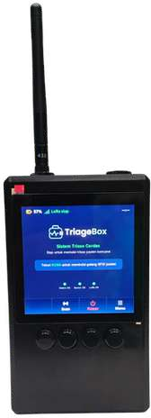
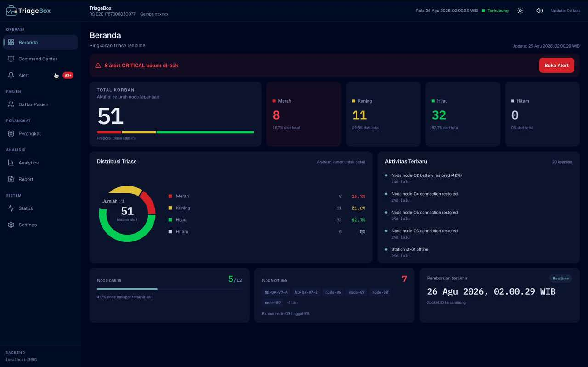
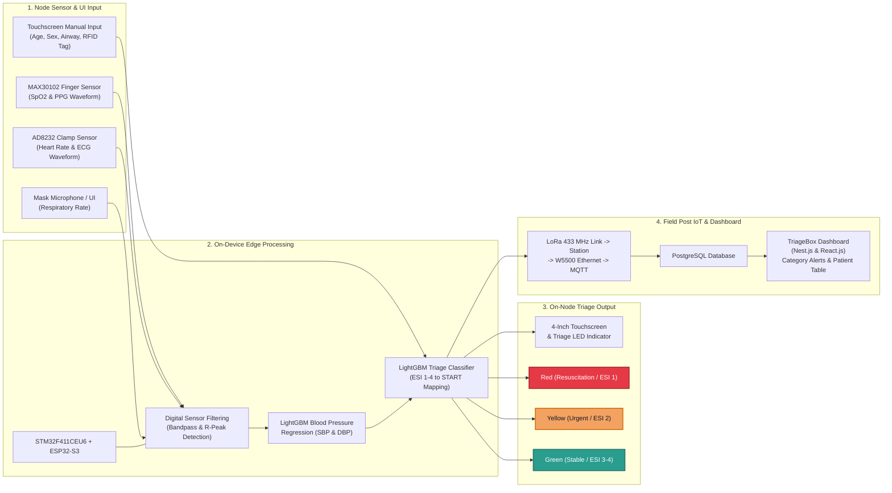

# Project Overview: TriageBox Smart ML-Integrated Triage Device

  PIMNAS 39 Silver &amp; Bronze
  STM32
  ESP32-S3
  LoRa
  LightGBM

 

  
   
  TriageBox team at Pekan Ilmiah Mahasiswa Nasional (PIMNAS) 39, awarded Silver Medal (2nd Place) in Presentation and Bronze Medal (3rd Place) in Poster under the PKM-Karsa Cipta (PKM-KC1) division.

## 1. Disaster Context, Problem Statement & Team Profile

**TriageBox** (*Alat Triase Cerdas Terintegrasi Machine Learning untuk Mempercepat Triase Korban Massal Bencana Gempa*) was developed under **Program Kreativitas Mahasiswa - Karsa Cipta (PKM-KC) 2026** at **Institut Teknologi Sepuluh Nopember (ITS)** to address two bottlenecks in mass-casualty earthquake response: slow manual vital-sign acquisition and unmonitored clinical deterioration at field evacuation posts.

During major earthquakes in Indonesia, field medical teams face overwhelming casualty surges alongside damaged hospital and telecommunications infrastructure:
- **High Casualty-to-Responder Ratios & Infrastructure Loss**: In the August 2026 M 7.7 Nagekeo (NTT / Flores) earthquake, BNPB and Ministry of Health reports recorded 135 fatalities, 1,787 injured casualties (385 requiring intensive care), and over 185,000 displaced residents across 444 evacuation points, while 19 of 190 community health centers (*puskesmas*) ceased operation, 3 of 21 hospitals suffered heavy structural damage, 200 of 812 cellular towers went offline, and each healthcare worker had to cover an average of 314 evacuees.
- **Unmonitored Post-Earthquake Deterioration**: Over 64% of the fatalities (87 of 135 deaths) occurred indirectly after the initial tremor, including evacuees whose condition deteriorated unmonitored while waiting at field posts prior to referral.
- **Slow Paper-Based Triage (5–10 Minutes per Patient)**: In both the 2022 Cianjur earthquake (~2,300 injured casualties) and recent disaster deployments, field responders still rely on manual paper triage tags (*lembar triase*). Measuring four core vital signs (blood pressure, heart rate, oxygen saturation, and respiratory rate) across four separate instruments and filling out paper forms takes **5 to 10 minutes per casualty**.

**TriageBox** replaces four separate diagnostic tools and paper tags with a single portable wearable node that acquires four vital signs in **57 seconds**, classifies triage urgency on-device in **~3 seconds** (**≤ 1 minute total**), tags the patient via an **RFID wristband**, and transmits live vital telemetry over an independent **500+ meter LoRa radio network** to a command post dashboard without needing grid electricity or cellular coverage.

### PKM-KC ITS 2026 Team & Roles

| Member | Department | Role & Primary Responsibilities |
| :--- | :--- | :--- |
| **Dr. Rudy Dikairono, S.T., M.T.** | Electrical Engineering | **Faculty Advisor** |
| **Yuke Brilliant Hestiavin** | Computer Engineering | **Team Leader & System Integrator**: System architecture, firmware-to-dashboard integration, and full-stack IoT command dashboard development. |
| **Aslam Pandu Tasminto** | Mathematics | **Software & Machine Learning Engineer**: Clinical START/ESI triage protocol mapping, physiological dataset preprocessing, and design, training, and evaluation of the on-device LightGBM cuffless blood pressure regression and triage classification models. |
| **Andika Rizky Noval Nugraha** | Electrical Engineering | **Electrical & Embedded Hardware Engineer**: Schematic and custom PCB design, sensor conditioning circuits (AD8232 ECG, MAX30102 PPG, RFID, LoRa), and STM32 signal acquisition firmware. |
| **Izza Azizah** | Biomedical Engineering | **Mechanical & Biomedical Engineer**: Portable enclosure CAD design, clinical sensor accuracy benchmarking against medical reference instruments, and user research with emergency medical personnel. |
| **Clarissa Aydin Rahmazea** | Information Technology | **Branding & Publication Lead**: Public relations (`@triagebox.its`), visual communication, scientific poster design, and documentation. |

---

## 2. System Architecture & Hardware Specifications

TriageBox is split into three parts: reusable **Wearable Patient Nodes** strapped to casualties during triage and waiting-room monitoring, a pole-mounted **LoRa Receiver Station** at the medical tent, and a local **Command Center Dashboard** for medical coordinators.

  <table>
    <tr>
      <th align="center">Wearable Patient Node</th>
      <th align="center">LoRa Receiver Station</th>
      <th align="center">Command Center Dashboard</th>
    </tr>
    <tr>
      <td align="center">
        
      </td>
      <td align="center">
        
      </td>
      <td align="center">
        
      </td>
    </tr>
    <tr>
      <td align="center"><em>4-vital-sign acquisition, RFID scanner, and on-device LightGBM inference</em></td>
      <td align="center"><em>Multi-node 433 MHz LoRa receiver with W5500 Ethernet bridge</em></td>
      <td align="center"><em>Real-time casualty triage board, Red-alert notifications, and RFID history</em></td>
    </tr>
  </table>

### Subsystem Technical Specifications

| Tier | Component / Parameter | Specification |
| :--- | :--- | :--- |
| **Wearable Patient Node** | **Dual Microcontrollers** | **STM32F411CEU6** (real-time sensor acquisition & digital bandpass filtering) + **ESP32-S3** (on-device LightGBM inference, touch UI, and radio control) |
| | **Physiological Sensors** | **MAX30102** finger clip (dual-wavelength PPG for SpO2 & pulse transit waveform), **AD8232** limb clamp (Lead-I ECG for heart rate & R-peak timing), oxygen-mask microphone via **GX12-5** aviation jack (respiratory rate, with manual UI fallback in noisy field zones) |
| | **Patient Identification** | Integrated **RFID Scanner** paired with per-casualty RFID wristbands |
| | **User Interface & Alerts** | 4-inch touchscreen display, 4 physical navigation buttons, high-visibility triage **LED indicator** (Red / Yellow / Green), and audible buzzer |
| | **Wireless & Power** | **SX1278 433 MHz LoRa** transceiver with external whip antenna; **3.7 V 5,000 mAh LiPo** battery (**7.5 hours** continuous runtime) |
| | **Dimensions & Weight** | **8.7 cm × 5.25 cm × 18.2 cm**; **471 grams** |
| **LoRa Receiver Station** | **Controller & Networking** | **ESP32** + **SX1278 433 MHz LoRa** module + **W5500 Ethernet** module in a weather-resistant pole-mounted enclosure; receives packets from multiple field nodes and publishes to the local server via **MQTT** |
| **Command Center Dashboard** | **Software Stack** | **Nest.js** backend, **React.js** frontend, **MQTT** message broker, and **PostgreSQL** database; provides real-time triage distribution, unacknowledged **Red (Critical)** alerts, per-wristband vital history, and hospital referral readiness |

### End-to-End System Dataflow (*Alur Sistem*)

### 5-Step Field Triage Workflow

1. **Casualty Arrival**: The injured survivor arrives at the field triage post and receives an RFID identification wristband.
2. **Sensor Attachment**: The responder attaches the MAX30102 finger clip, AD8232 ECG limb clamps, and respiratory mask sensor.
3. **Node Acquisition & Edge Inference**: The TriageBox node is strapped to the patient's arm, scans the RFID wristband, records 57 seconds of synchronized waveforms, and computes blood pressure and START triage priority on-device in ~3 seconds.
4. **LoRa Telemetry Transmission**: Vital signs and the assigned triage category (Red, Yellow, or Green) are displayed immediately on the node's 4-inch screen and LED, while telemetry packets are broadcast over 433 MHz LoRa to the post's Receiver Station.
5. **Post Monitoring & Referral**: The Command Center Dashboard logs the patient's record, highlights critical Red casualties or sudden category downgrades, and tracks waiting patients until hospital evacuation.

---

## 3. Core Machine Learning Pipeline

My primary technical contribution to TriageBox was designing, training, and optimizing the two-stage on-device **LightGBM** pipeline that enables cuffless blood pressure estimation from ECG/PPG pulse transit dynamics and maps clinical Emergency Severity Index (ESI) acuity predictions into 3-color START disaster triage priorities on the ESP32-S3 microcontroller:

  

    
<a href="{{ '/pages/projects/ml_pipeline_triagebox.html' | relative_url }}">Machine Learning Pipeline based on LightGBM for Triage Classification and Blood Pressure Regression</a>

    Jul – Oct 2026
  

  
Two-stage LightGBM pipeline running on ESP32-S3: cuffless systolic and diastolic blood pressure estimation from ECG/PPG features (1.56 / 1.15 mmHg MAE), followed by ESI-to-START triage classification (94.24% Red sensitivity, 90.17% balanced accuracy).

---

## 4. Verification Results & Technology Benchmarking

### Hardware & Software Verification Summary

| Subsystem | Verification Benchmark | Measured Result |
| :--- | :--- | :--- |
| **Heart Rate (AD8232 ECG)** | 5 post-exercise subjects × 5 trials vs. Easy ECG clinical monitor | **1.04 bpm MAE** |
| **Oxygen Saturation (MAX30102)** | 5 post-exercise subjects × 5 trials vs. commercial pulse oximeter | **0.8 percentage-point MAE** |
| **Cuffless Blood Pressure (LightGBM)** | 148 subjects, 444 recordings (Li et al., 2026); 70/20/10 train/val/test split | **1.56 mmHg SBP MAE / 1.15 mmHg DBP MAE** (2.51 s inference time) |
| **Triage Classification (LightGBM)** | 87,234 ESI encounters (Imanov & Dulger, 2026); 70/15/15 split mapped to START (Phattharapornjaroen et al., 2026) | **94.24% Red sensitivity / 90.17% 3-class balanced accuracy** (21.04 ms inference time) |
| **LoRa SX1278 Radio Link** | Field range & latency test across building-obstructed urban path with stock antenna | **504.75 m range** at **581 ms latency** |
| **Node Battery Endurance** | Continuous acquisition, screen, inference, and LoRa transmission on 5,000 mAh LiPo | **7.5 hours** runtime |

### Comparison with Existing Triage & Vital-Monitoring Technologies

| Parameter | RescueWave | Athena WVSM | E-Triage Tag | Biobeat | **TriageBox (Ours)** |
| :--- | :---: | :---: | :---: | :---: | :---: |
| **Primary Function** | Digital triage tag | Vital sign monitor | Electronic triage tag | Blood pressure monitor | **Automated triage + continuous monitoring** |
| **Measured Vital Signs** | 0 | 4 | 2 | 5 | **4 (HR, SpO2, cuffless BP, RR)** |
| **Manual Clinical Inputs** | Color only | Triage color only | None | None | **3 fields (Age, Sex, Airway) + optional RR** |
| **Time to Triage Result** | Manual | Manual | ≥ 1 min | ≥ 5 min | **≤ 1 min (57 s capture + ~3 s inference)** |
| **Classification Compute** | Manual | Manual | Central Server | Cloud | **On-Device Edge ML (ESP32-S3)** |
| **Communication Link** | 7 km radio | 183 m wireless | Wi-Fi dependent | Internet dependent | **Self-contained LoRa (504.75 m NLOS)** |
| **Patient Identification** | QR code | None | None | None | **RFID Wristband** |
